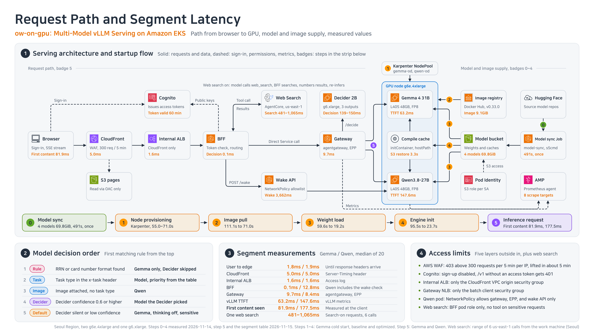
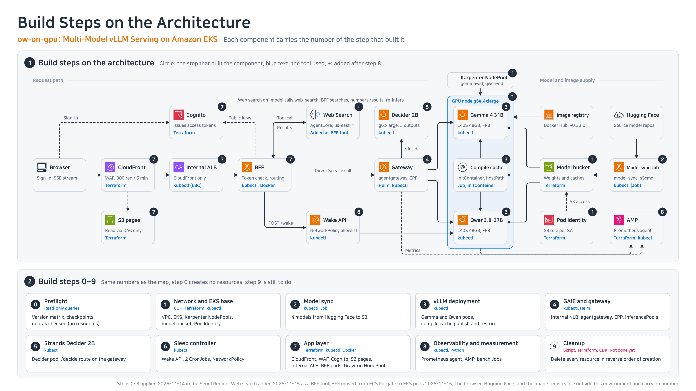
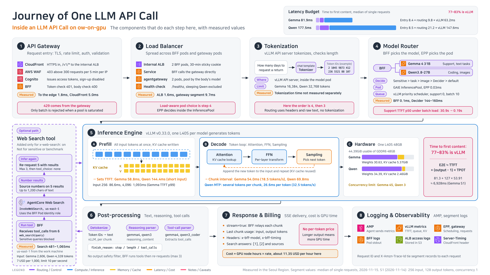
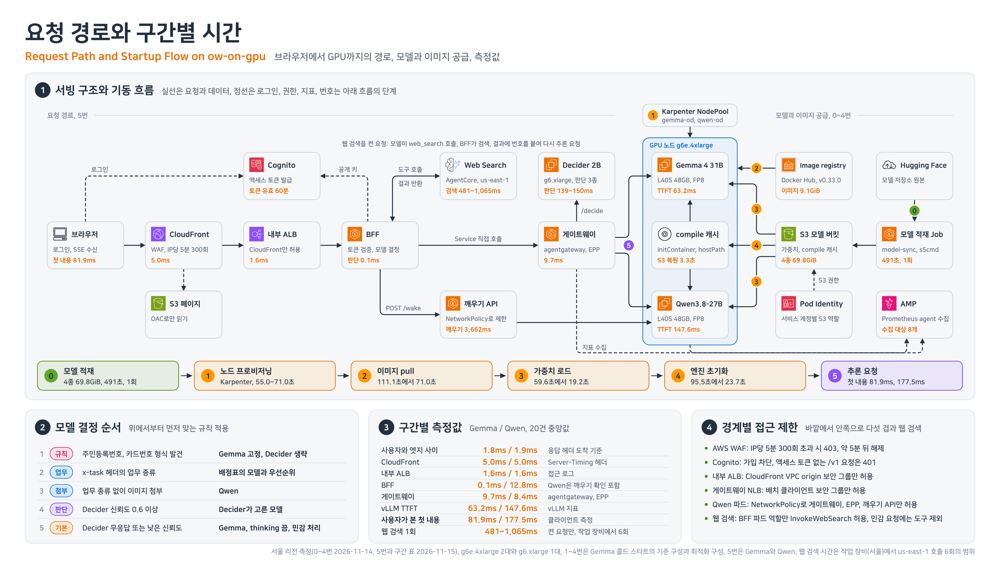
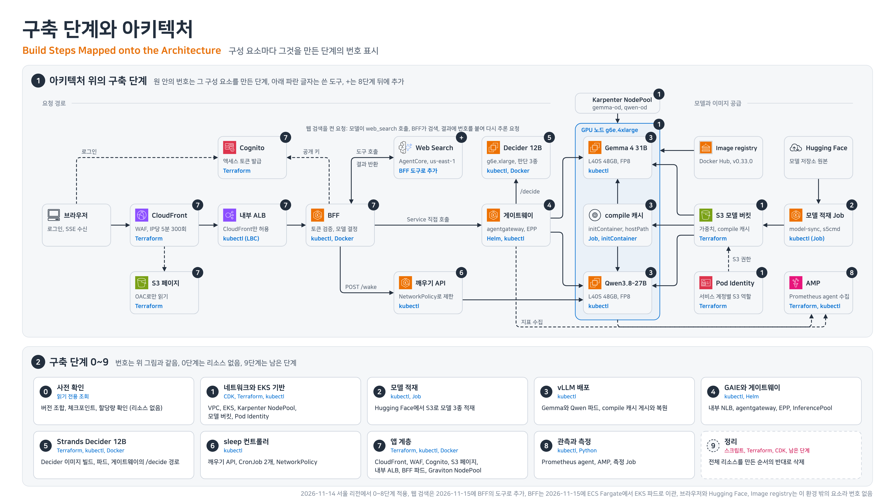
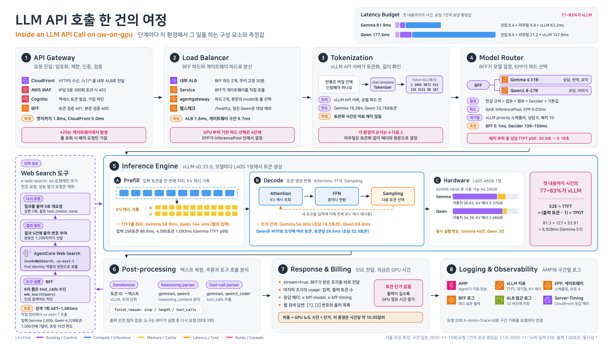

# ow-on-gpu

[](#english)
[](#한국어)

Serve Gemma 4 31B and Qwen3.8-27B with vLLM on Amazon EKS and measure them | Amazon EKS에서 vLLM으로 Gemma 4 31B와 Qwen3.8-27B를 서빙하고 측정합니다

---

<a id="english"></a>

# English

## Overview

ow-on-gpu is the measurement environment for part 3 of the blog series on optimising vLLM serving on Amazon EKS. Two g6e.4xlarge nodes (one L40S each) serve Gemma 4 31B and Qwen3.8-27B with vLLM v0.33.0 behind an inference gateway, and a BFF in front of the gateway decides which model receives each request. The repository holds the infrastructure code, the Kubernetes manifests, the BFF and a check page, the measurement scripts, the raw results and the documents written at each build stage.

The rules, the confirmed decisions and the known pitfalls of this project are in [AGENT.md](AGENT.md). The overall structure is in [docs/architecture.md](docs/architecture.md), and the measured results are in [docs/08-results.md](docs/08-results.md).

### Architecture

Three infographics show the environment from different angles. Each figure follows the light or dark theme of GitHub. The SVG files with the same names are in `docs/infographic/build/`, and `docs/infographic/build.sh` rebuilds them.

**Request Path and Segment Latency.** The path from the browser to the GPU nodes, the supply of models and images, the order in which the BFF picks a model, the time measured in each segment and the access limit at each boundary.

<picture>
  <source media="(prefers-color-scheme: dark)" srcset="docs/infographic/build/08-request-flow-en_16x9_dark.png">
  
</picture>

**Build Steps on the Architecture.** Each component carries the number of the build stage that created it. The numbers are the stages in the table under [Installation](#installation).

<picture>
  <source media="(prefers-color-scheme: dark)" srcset="docs/infographic/build/10-build-steps-en_16x9_dark.png">
  
</picture>

**Journey of One LLM API Call.** The eight stages one request passes through, each with the component that does the job in this environment and its measured value.

<picture>
  <source media="(prefers-color-scheme: dark)" srcset="docs/infographic/build/09-llm-api-call-en_16x9_dark.png">
  
</picture>

## Features

- **Two models behind one gateway** — Gemma 4 31B and Qwen3.8-27B run on separate g6e.4xlarge nodes, and Gateway API Inference Extension with agentgateway routes each request by the `model` field of its body.
- **Request routing in a BFF** — Deterministic rules send requests with sensitive data to Gemma, task types pick a model directly, and a 2B Decider model is asked once per session for the rest.
- **Shorter cold start** — Loading weights from Amazon S3 and restoring the compile cache cut the Gemma cold start from 394 s to 260 s and the warm restart from 214 s to 86 s.
- **Sleep mode for the internal model** — Qwen sleeps outside working hours and wakes in 3.66 s when the BFF calls the wake API.
- **Priority scheduling** — With batch load running, engine priority brought the median time to first token of interactive requests from 30.9 s to 0.19 s.
- **Tool calls run by the BFF** — An order lookup and a web search through Amazon Bedrock AgentCore Web Search, with numbered sources in the answer.
- **Login-protected endpoint** — CloudFront with AWS WAF and a Cognito user pool in front, an internal ALB and private pods behind.
- **Check page** — Eight views that show token arrival, routing reasons and per-segment timings, in Korean and English.
- **Raw measurement data** — Every number in the documents is backed by files under `results/`.

## Prerequisites

- An AWS account with capacity for two g6e.4xlarge and one g6.xlarge instance in ap-northeast-2
- AWS CLI, kubectl, Terraform 1.14 or later, Docker, Node.js with npm
- jq, python3 and Bash 4 or later for the hooks and the harness tests
- For the infographics: a Python with Pillow and Playwright, the NanumSquareOTF and D2Coding fonts, the icon bundle of the aws-diagram skill

The GPU nodes are billed while they run. With every component running, the fixed cost was about 10.05 USD per hour as of 2026-11-15 (`docs/07-bff.md`).

## Installation

Prepare the working environment first. These steps create no AWS resource.

```bash
# 1. Clone the repository
git clone https://github.com/whchoi98/ow-on-gpu.git
cd ow-on-gpu

# 2. Check the tools, install the git hooks, copy the example files, install the page dependencies
bash scripts/setup.sh

# 3. Confirm that the working tools run
bash tests/run-all.sh
```

Five files that hold environment-specific values (model bucket name, Prometheus workspace ID, public IP) are not in the repository. `scripts/setup.sh` copies their `*.example` files. Replace the placeholders with your own values (`docs/onboarding.md`).

Build the environment in the order of the stages in `prompts.md`. Before any AWS resource is created, changed or deleted, show the `terraform plan` or `kubectl diff` output and get approval. The stage numbers are the circled numbers in the build steps figure under [Architecture](#architecture).

| Stage | What it builds | Code | Record |
|---|---|---|---|
| 0 | Version check | - | `docs/00-versions.md` |
| 1 | Network and EKS | `infra/cdk-vpc`, `infra/terraform`, `k8s/base` | `AGENT.md` |
| 2 | Model load into S3 | `jobs/model-sync` | `jobs/model-sync/README.md` |
| 3 | vLLM | `k8s/gemma`, `k8s/qwen`, `jobs/cache-publish` | `docs/03-vllm.md` |
| 4 | Gateway | `k8s/gateway` | `docs/04-gateway.md` |
| 5 | Decider | `k8s/decider` | `docs/05-decider.md` |
| 6 | Sleep controller | `k8s/sleep-controller` | `docs/06-sleep.md` |
| 7 | App layer | `app/bff`, `app/web`, `k8s/bff`, `infra/terraform/app.tf` | `docs/07-bff.md` |
| 8 | Observability and measurement | `k8s/observability`, `bench` | `docs/08-results.md` |
| 9 | Cleanup | not done yet | - |

## Usage

Use the project kubeconfig so the default context of a shared machine stays untouched.

```bash
export KUBECONFIG=$PWD/infra/terraform/.kubeconfig
kubectl get nodes -L node.kubernetes.io/instance-type,karpenter.sh/nodepool
# 9 nodes with every component running (2026-11-16):
#   2 x m7g.large (addons), 2 x c7i-flex.xlarge (system), 2 x c7g.large (app),
#   2 x g6e.4xlarge (gemma-od, qwen-od), 1 x g6.xlarge (decider)
```

Open the site address, sign in with a Cognito user and send a request from the check page.

```bash
terraform -chdir=infra/terraform output -raw app_url
# https://<cloudfront-domain>
```

Deploy a BFF change. Show the difference first and apply after approval.

```bash
app/bff/build.sh              # build the image and push it to Amazon ECR
k8s/bff/install.sh diff       # show the difference
k8s/bff/install.sh apply      # apply after approval
```

Deploy a page change.

```bash
app/web/build.sh              # npm ci, npm test, npm run build
terraform -chdir=infra/terraform plan -target=aws_s3_object.web -out=web.tfplan
terraform -chdir=infra/terraform apply web.tfplan
```

Check a deployment without the demo password.

```bash
python bench/bff/lang_check_live.py "$(terraform -chdir=infra/terraform output -raw app_url)"
# 401 without a token. The message is "Sign-in is required" when x-lang is en
kubectl -n app exec -i <bff-pod> -- python - < bench/bff/lang_check_in_pod.py
```

## Configuration

| Variable | Description | Default |
|---|---|---|
| `KUBECONFIG` | Project kubeconfig used by kubectl | `infra/terraform/.kubeconfig` |
| `AWS_REGION` | Region of the environment | `ap-northeast-2` |
| `USER_PASSWORD` | Demo account password, passed on the command line only and never stored in a file | - |
| `INFOKIT_FONTS` | Font directory for the infographic build | - |
| `AWS_ICON_BUNDLE` | Icon bundle of the aws-diagram skill | - |
| `PYTHON` | Python with Pillow and Playwright for the infographic build | - |
| `CLAUDE_NOTIFY_WEBHOOK` | Webhook for Claude Code notifications | - |
| `DECIDER_MIN_CONFIDENCE` | BFF: confidence below which the Decider answer is not used | `0.6` |
| `DECIDER_TIMEOUT_SECONDS` | BFF: time limit of a Decider call | `2` |
| `SESSION_TTL_SECONDS` | BFF: how long a session keeps its decision | `1800` |
| `WAKE_RETRY_SECONDS` | BFF: how long requests are retried after Qwen wakes | `10` |
| `waf_rate_limit` | Terraform: requests one IP may send in 5 minutes | `300` |

## Project Structure

```text
ow-on-gpu/
├── AGENT.md                # Purpose, confirmed decisions, working rules, pitfalls
├── CLAUDE.md               # Loads AGENT.md and describes the working tools
├── prompts.md              # Prompts for build stages 0 to 9
├── infra/
│   ├── cdk-vpc/            # VPC as an AWS CDK stack
│   └── terraform/          # EKS, Karpenter, IAM, S3, CloudFront, WAF, Cognito
├── k8s/                    # Manifests: base, gemma, qwen, decider, gateway, sleep-controller, bff, observability, bench
├── jobs/                   # Jobs that load weights and publish compile caches to S3
├── app/
│   ├── bff/                # BFF (Python, aiohttp)
│   └── web/                # Check page (React, Vite)
├── bench/                  # Measurement and post-deploy check scripts
├── results/                # Raw measurement data
├── docs/                   # Stage records, architecture, API reference, layer references
│   └── infographic/        # Infographic sources and the built figures (build/)
├── blog/                   # Working folders of the three blog drafts
├── reference/              # Reference figures for the infographics
├── source-doc/             # First originals of the blog drafts
├── tests/                  # Harness tests (hooks, settings, structure)
├── scripts/                # Setup, git hook installer, identifier masking
└── .claude/                # Claude Code settings, hooks, skills, commands, agents
```

## Testing

```bash
# Harness: hooks, settings, document structure and pointers. Exits 0 when every test passes
bash tests/run-all.sh

# One harness suite by name: hooks or structure
bash tests/run-all.sh structure

# Check page: every test file, or one file
npm test --prefix app/web
(cd app/web && node i18n.test.mjs)
# i18n: ok

# BFF, inside its image: every test, or one class
docker run --rm -v "$PWD/app/bff":/app:ro -w /app <bff-image> python -m unittest test_bff
# Ran 34 tests ... OK
docker run --rm -v "$PWD/app/bff":/app:ro -w /app <bff-image> python -m unittest test_bff.RoutingRules
```

These tests create no AWS resource and call no model. No coverage tool is configured, so coverage is not measured.

## API Documentation

The BFF exposes an OpenAI-compatible endpoint and three helper paths. Request headers, response headers and error bodies are in [docs/api-reference.md](docs/api-reference.md).

```text
POST /v1/chat/completions
POST /v1/route
GET  /v1/status
GET  /healthz
```

## Contributing

1. Fork the repository.
2. Create a branch: `git checkout -b feat/short-description`.
3. Commit with Conventional Commits: `feat: add a routing rule`, `fix: keep the SSE stream unbuffered`.
4. Push the branch: `git push origin feat/short-description`.
5. Open a pull request that says what was changed and how it was checked.

Changes that touch AWS resources follow the working rules in `AGENT.md`: show the plan or diff first and apply after approval. Numbers in documents must come from measurements stored under `results/`.

## License

This repository does not include a LICENSE file yet. No license has been chosen.

## Contact

- Maintainer: [WooHyung Choi (whchoi98)](https://github.com/whchoi98)
- Issues: [github.com/whchoi98/ow-on-gpu/issues](https://github.com/whchoi98/ow-on-gpu/issues)

---

<a id="korean"></a>

# 한국어

## 개요

ow-on-gpu는 블로그 시리즈 "EKS 기반 vLLM 서빙 최적화" 3부의 측정 환경입니다. g6e.4xlarge 노드 2대(각각 L40S 1장)가 추론 게이트웨이 뒤에서 vLLM v0.33.0으로 Gemma 4 31B와 Qwen3.8-27B를 서빙하고, 게이트웨이 앞의 BFF가 요청마다 어느 모델로 보낼지 정합니다. 이 저장소에는 인프라 코드, 쿠버네티스 매니페스트, BFF와 확인용 페이지, 측정 스크립트, 원시 결과, 구축 단계마다 쓴 문서가 있습니다.

이 프로젝트의 규칙, 확정된 결정, 알려진 함정은 [AGENT.md](AGENT.md)에 있습니다. 전체 구조는 [docs/architecture.md](docs/architecture.md)에, 측정 결과는 [docs/08-results.md](docs/08-results.md)에 있습니다.

### 아키텍처

인포그래픽 세 장이 같은 환경을 서로 다른 관점에서 보여 줍니다. 그림은 GitHub의 라이트, 다크 테마를 따라 바뀝니다. 같은 이름의 SVG 파일이 `docs/infographic/build/`에 있고, `docs/infographic/build.sh`로 다시 만듭니다.

**요청 경로와 구간별 시간.** 브라우저에서 GPU 노드까지의 경로, 모델과 이미지를 공급하는 흐름, BFF가 모델을 정하는 순서, 구간마다 측정한 시간, 경계마다 둔 접근 제한을 담았습니다.

<picture>
  <source media="(prefers-color-scheme: dark)" srcset="docs/infographic/build/08-request-flow_16x9_dark.png">
  
</picture>

**구축 단계와 아키텍처.** 구성 요소마다 그것을 만든 구축 단계의 번호가 붙어 있습니다. 번호는 [설치 방법](#설치-방법)에 있는 표의 단계와 같습니다.

<picture>
  <source media="(prefers-color-scheme: dark)" srcset="docs/infographic/build/10-build-steps_16x9_dark.png">
  
</picture>

**LLM API 호출 한 건의 여정.** 요청 하나가 거치는 여덟 단계마다 이 환경에서 그 일을 하는 구성 요소와 측정값을 적었습니다.

<picture>
  <source media="(prefers-color-scheme: dark)" srcset="docs/infographic/build/09-llm-api-call_16x9_dark.png">
  
</picture>

## 주요 기능

- **게이트웨이 하나 뒤의 두 모델** — Gemma 4 31B와 Qwen3.8-27B가 각자의 g6e.4xlarge 노드에서 실행되고, Gateway API Inference Extension과 agentgateway가 요청 본문의 `model` 값으로 경로를 고릅니다.
- **BFF의 요청 경로 결정** — 결정적 규칙이 민감 정보가 있는 요청을 Gemma로 보내고, 업무 종류가 있으면 모델을 바로 정하고, 나머지는 2B Decider 모델에 세션마다 한 번 묻습니다.
- **짧아진 콜드 스타트** — Amazon S3에서 가중치를 읽고 compile 캐시를 복원해 Gemma의 콜드 스타트가 394초에서 260초로, 웜 재시작이 214초에서 86초로 줄었습니다.
- **내부 업무 모델의 sleep mode** — Qwen은 업무 시간 밖에 잠들고, BFF가 깨우기 API를 부르면 3.66초에 깨어납니다.
- **우선순위 스케줄링** — 배치 부하가 있을 때 엔진 우선순위가 상담 요청의 첫 토큰까지 시간(중앙값)을 30.9초에서 0.19초로 줄였습니다.
- **BFF가 실행하는 도구 호출** — 주문 조회와 Amazon Bedrock AgentCore Web Search를 통한 웹 검색을 실행하고 답변에 출처 번호를 붙입니다.
- **로그인으로 보호한 진입점** — 앞에는 AWS WAF가 붙은 CloudFront와 Cognito 사용자 풀, 뒤에는 내부 ALB와 프라이빗 파드가 있습니다.
- **확인용 페이지** — 토큰이 도착하는 순간, 경로를 정한 이유, 구간별 시간을 보여 주는 보기 여덟 개가 한국어와 영어로 있습니다.
- **측정 원시 자료** — 문서의 모든 수치는 `results/` 아래의 파일로 뒷받침됩니다.

## 사전 요구 사항

- ap-northeast-2에서 g6e.4xlarge 2대와 g6.xlarge 1대를 띄울 수 있는 AWS 계정
- AWS CLI, kubectl, Terraform 1.14 이상, Docker, Node.js와 npm
- 훅과 하네스 시험에 쓰는 jq, python3, Bash 4 이상
- 인포그래픽을 만들려면 Pillow와 Playwright가 있는 Python, 나눔스퀘어OTF와 D2Coding 폰트, aws-diagram 스킬의 아이콘 묶음

GPU 노드는 실행 중인 동안 요금이 나옵니다. 모든 구성 요소가 실행 중일 때의 고정 비용은 2026-11-15 기준 시간당 약 10.05달러였습니다(`docs/07-bff.md`).

## 설치 방법

먼저 작업 환경을 준비합니다. 이 단계들은 AWS 리소스를 만들지 않습니다.

```bash
# 1. 저장소를 복제합니다
git clone https://github.com/whchoi98/ow-on-gpu.git
cd ow-on-gpu

# 2. 도구를 확인하고, git 훅을 설치하고, 예시 파일을 복사하고, 화면의 의존성을 설치합니다
bash scripts/setup.sh

# 3. 작업 도구가 동작하는지 확인합니다
bash tests/run-all.sh
```

환경별 값(모델 버킷 이름, Prometheus 작업 공간 ID, 공인 IP)이 든 파일 다섯 개는 저장소에 없습니다. `scripts/setup.sh`가 `*.example` 파일을 복사합니다. 자리 표시를 실제 값으로 바꿉니다(`docs/onboarding.md`).

`prompts.md`의 단계 순서대로 환경을 만듭니다. AWS 리소스를 만들거나 바꾸거나 지우기 전에 `terraform plan` 또는 `kubectl diff` 결과를 보여 주고 승인을 받습니다. 단계 번호는 [아키텍처](#아키텍처)의 구축 단계 그림에서 원 안에 든 번호와 같습니다.

| 단계 | 만드는 것 | 코드 | 기록 |
|---|---|---|---|
| 0 | 버전 확인 | - | `docs/00-versions.md` |
| 1 | 네트워크와 EKS | `infra/cdk-vpc`, `infra/terraform`, `k8s/base` | `AGENT.md` |
| 2 | S3에 모델 적재 | `jobs/model-sync` | `jobs/model-sync/README.md` |
| 3 | vLLM | `k8s/gemma`, `k8s/qwen`, `jobs/cache-publish` | `docs/03-vllm.md` |
| 4 | 게이트웨이 | `k8s/gateway` | `docs/04-gateway.md` |
| 5 | Decider | `k8s/decider` | `docs/05-decider.md` |
| 6 | sleep 컨트롤러 | `k8s/sleep-controller` | `docs/06-sleep.md` |
| 7 | 앱 계층 | `app/bff`, `app/web`, `k8s/bff`, `infra/terraform/app.tf` | `docs/07-bff.md` |
| 8 | 관측과 측정 | `k8s/observability`, `bench` | `docs/08-results.md` |
| 9 | 정리 | 아직 하지 않음 | - |

## 사용법

프로젝트 전용 kubeconfig를 씁니다. 공유 장비의 기본 컨텍스트를 건드리지 않기 위해서입니다.

```bash
export KUBECONFIG=$PWD/infra/terraform/.kubeconfig
kubectl get nodes -L node.kubernetes.io/instance-type,karpenter.sh/nodepool
# 모든 구성 요소가 실행 중일 때 노드 9대 (2026-11-16):
#   m7g.large 2대(addons), c7i-flex.xlarge 2대(system), c7g.large 2대(app),
#   g6e.4xlarge 2대(gemma-od, qwen-od), g6.xlarge 1대(decider)
```

사이트 주소를 열고 Cognito 사용자로 로그인한 뒤 확인용 페이지에서 요청을 보냅니다.

```bash
terraform -chdir=infra/terraform output -raw app_url
# https://<cloudfront-domain>
```

BFF 변경을 배포합니다. 차이를 먼저 보여 주고 승인 뒤에 적용합니다.

```bash
app/bff/build.sh              # 이미지를 빌드해 Amazon ECR에 올립니다
k8s/bff/install.sh diff       # 차이를 보여 줍니다
k8s/bff/install.sh apply      # 승인 뒤에 적용합니다
```

화면 변경을 배포합니다.

```bash
app/web/build.sh              # npm ci, npm test, npm run build
terraform -chdir=infra/terraform plan -target=aws_s3_object.web -out=web.tfplan
terraform -chdir=infra/terraform apply web.tfplan
```

데모 계정 비밀번호 없이 배포를 확인합니다.

```bash
python bench/bff/lang_check_live.py "$(terraform -chdir=infra/terraform output -raw app_url)"
# 토큰이 없으면 401. x-lang이 en이면 문구가 "Sign-in is required", 아니면 "로그인이 필요합니다"
kubectl -n app exec -i <bff-pod> -- python - < bench/bff/lang_check_in_pod.py
```

## 환경 설정

| 변수 | 설명 | 기본값 |
|---|---|---|
| `KUBECONFIG` | kubectl이 쓰는 프로젝트 전용 kubeconfig | `infra/terraform/.kubeconfig` |
| `AWS_REGION` | 환경의 리전 | `ap-northeast-2` |
| `USER_PASSWORD` | 데모 계정 비밀번호. 명령에만 붙여 넘기고 파일에 저장하지 않습니다 | - |
| `INFOKIT_FONTS` | 인포그래픽 빌드에 쓰는 폰트 디렉터리 | - |
| `AWS_ICON_BUNDLE` | aws-diagram 스킬의 아이콘 묶음 | - |
| `PYTHON` | 인포그래픽 빌드에 쓰는, Pillow와 Playwright가 있는 Python | - |
| `CLAUDE_NOTIFY_WEBHOOK` | Claude Code 알림을 보낼 웹훅 | - |
| `DECIDER_MIN_CONFIDENCE` | BFF: 이 값보다 신뢰도가 낮으면 Decider의 답을 쓰지 않습니다 | `0.6` |
| `DECIDER_TIMEOUT_SECONDS` | BFF: Decider 호출의 제한 시간 | `2` |
| `SESSION_TTL_SECONDS` | BFF: 세션이 결정을 유지하는 시간 | `1800` |
| `WAKE_RETRY_SECONDS` | BFF: Qwen이 깨어난 뒤 요청을 다시 시도하는 시간 | `10` |
| `waf_rate_limit` | Terraform: IP 하나가 5분 동안 보낼 수 있는 요청 수 | `300` |

## 프로젝트 구조

```text
ow-on-gpu/
├── AGENT.md                # 목적, 확정된 결정, 작업 규칙, 알려진 함정
├── CLAUDE.md               # AGENT.md를 불러오고 작업 도구의 쓰임을 적음
├── prompts.md              # 구축 0단계에서 9단계까지의 프롬프트
├── infra/
│   ├── cdk-vpc/            # AWS CDK 스택으로 만든 VPC
│   └── terraform/          # EKS, Karpenter, IAM, S3, CloudFront, WAF, Cognito
├── k8s/                    # 매니페스트: base, gemma, qwen, decider, gateway, sleep-controller, bff, observability, bench
├── jobs/                   # 가중치를 적재하고 compile 캐시를 S3에 게시하는 Job
├── app/
│   ├── bff/                # BFF (Python, aiohttp)
│   └── web/                # 확인용 페이지 (React, Vite)
├── bench/                  # 측정 스크립트와 배포 뒤 확인 스크립트
├── results/                # 측정 원시 자료
├── docs/                   # 단계별 기록, 아키텍처, API 참조, 층별 참조
│   └── infographic/        # 인포그래픽 소스와 만든 그림(build/)
├── blog/                   # 블로그 원고 3부작의 작업 폴더
├── reference/              # 인포그래픽의 참조 그림
├── source-doc/             # 블로그 원고의 첫 원본
├── tests/                  # 하네스 시험 (훅, 설정, 구조)
├── scripts/                # 작업 환경 준비, git 훅 설치, 식별 값 가리기
└── .claude/                # Claude Code 설정, 훅, 스킬, 명령, 에이전트
```

## 테스트

```bash
# 하네스: 훅, 설정, 문서의 구조와 포인터. 모두 통과하면 종료 코드가 0입니다
bash tests/run-all.sh

# 하네스의 한 묶음만 이름으로 실행: hooks 또는 structure
bash tests/run-all.sh structure

# 확인용 페이지: 시험 파일 전부, 또는 파일 하나
npm test --prefix app/web
(cd app/web && node i18n.test.mjs)
# i18n: ok

# BFF. 이미지 안에서 실행: 시험 전부, 또는 클래스 하나
docker run --rm -v "$PWD/app/bff":/app:ro -w /app <bff-image> python -m unittest test_bff
# Ran 34 tests ... OK
docker run --rm -v "$PWD/app/bff":/app:ro -w /app <bff-image> python -m unittest test_bff.RoutingRules
```

이 시험들은 AWS 리소스를 만들지 않고 모델을 부르지 않습니다. 커버리지 도구를 설정하지 않아 커버리지는 재지 않습니다.

## API 문서

BFF는 OpenAI 호환 경로 하나와 보조 경로 셋을 제공합니다. 요청 헤더, 응답 헤더, 오류 본문은 [docs/api-reference.md](docs/api-reference.md)에 있습니다.

```text
POST /v1/chat/completions
POST /v1/route
GET  /v1/status
GET  /healthz
```

## 기여 방법

1. 저장소를 Fork합니다.
2. 브랜치를 만듭니다: `git checkout -b feat/short-description`.
3. Conventional Commits 형식으로 커밋합니다: `feat: add a routing rule`, `fix: keep the SSE stream unbuffered`.
4. 브랜치를 Push합니다: `git push origin feat/short-description`.
5. 무엇을 바꿨고 어떻게 확인했는지 적어 Pull Request를 엽니다.

AWS 리소스를 건드리는 변경은 `AGENT.md`의 작업 규칙을 따릅니다. plan이나 diff를 먼저 보여 주고 승인 뒤에 적용합니다. 문서의 수치는 `results/`에 저장한 측정에서 나와야 합니다.

## 라이선스

이 저장소에는 아직 LICENSE 파일이 없습니다. 라이선스를 정하지 않았습니다.

## 연락처

- 관리자: [WooHyung Choi (whchoi98)](https://github.com/whchoi98)
- 이슈: [github.com/whchoi98/ow-on-gpu/issues](https://github.com/whchoi98/ow-on-gpu/issues)
