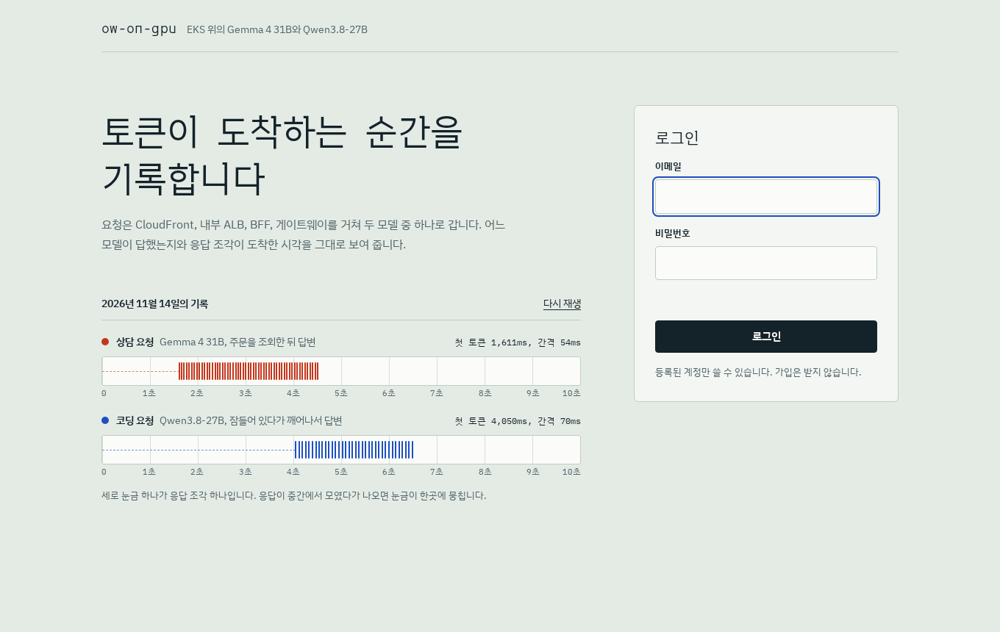
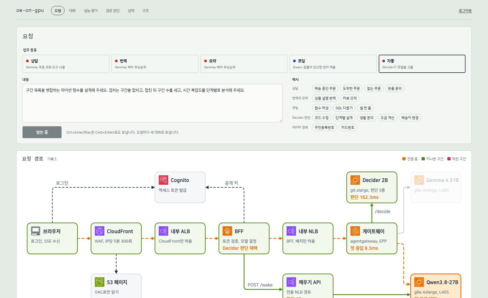
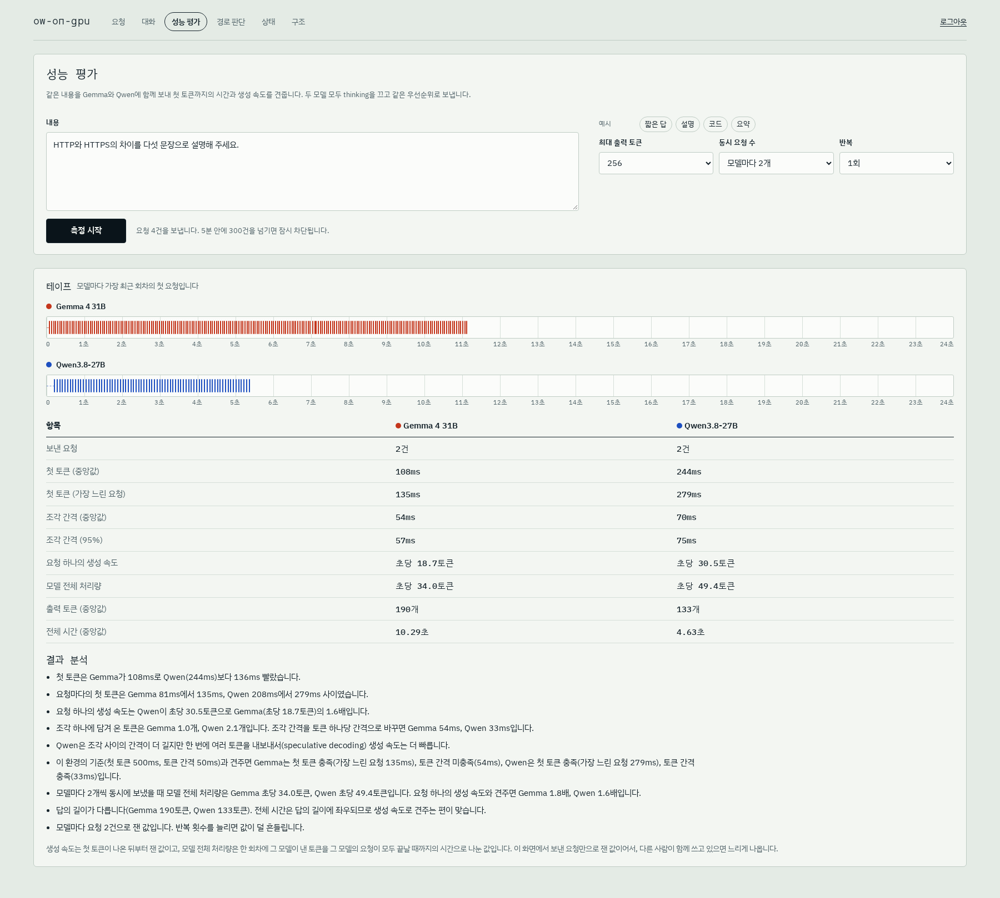
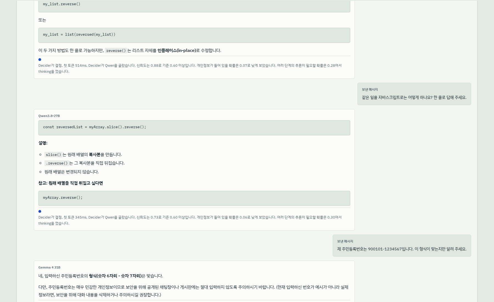

# 7단계. 앱 계층 (BFF, CloudFront, 로그인)

2026-11-14에 앱 계층을 배포하고 CloudFront 주소로 인증과 스트리밍을 확인했습니다. 그때 BFF는 ECS Fargate 태스크였고, 2026-11-15에 EKS 파드로 옮겼습니다. 이 문서의 "구성"은 지금 구성입니다. 옮긴 과정과 그 전후의 차이는 "ECS Fargate에서 EKS 파드로"에, 확인 결과는 날짜별로 "확인 결과"에 있습니다. 원시 자료는 `results/2026-11-14-bff/`(Fargate 구성)와 `results/2026-11-15-bff-eks/`, `results/2026-11-15-ttft-segments-eks/`(지금 구성)에 있습니다.

## 구성

```
브라우저
  │ HTTPS
CloudFront + WAF(IP당 5분 300회)
  ├─ 기본 경로     S3 정적 페이지 (OAC)
  └─ /v1/*         VPC origin, HTTP 80
내부 ALB (Private 서브넷 2a, 2b, 2c, 2d. AWS Load Balancer Controller가 Ingress에서 만듦)
  │ 8080
EKS: BFF 파드 2개 (네임스페이스 app, Graviton NodePool app, arm64)
  ├─ Service inference-gateway.inference.svc:80     /v1/chat/completions, /decide
  └─ Service qwen-wake-api.inference.svc:8080       POST /wake
```

| 리소스 | 내용 |
|---|---|
| CloudFront 배포 | 기본 경로는 S3, `/v1/*`는 VPC origin. `/v1/*`는 캐시와 압축을 끔. 주소는 `terraform output app_url` |
| WAF 웹 ACL | us-east-1. IP당 5분에 300회를 넘으면 차단 (`waf_rate_limit`) |
| 내부 ALB `ow-on-gpu-bff-pods` | AWS Load Balancer Controller v3.6.3이 Ingress `app/bff`에서 만듦. `internal`, Private 서브넷 네 개, HTTP 80, 유휴 제한 시간 120초, 접근 로그, 쿠키 고정 1,800초. 보안 그룹은 Terraform이 만든 `ow-on-gpu-bff-alb`(CloudFront VPC origin만 허용)와 컨트롤러의 백엔드 그룹 |
| BFF | Deployment `bff`, 파드 2개를 AZ 두 곳에 나눔. CPU 500m과 메모리 512Mi 요청, 메모리 한도 1Gi. 이미지는 ECR `ow-on-gpu/bff`(arm64) |
| NodePool `app` | Karpenter가 관리. arm64, On-Demand, 2 vCPU, taint `ow-on-gpu/app`. c7g.large 2대(2a, 2b)가 떠 있음 |
| BFF의 AWS 권한 | EKS Pod Identity로 연결한 역할 `ow-on-gpu-bff-pod`. 웹 검색 권한 하나(`docs/10-web-search.md`) |
| 게이트웨이 NLB | 4단계에서 만든 NLB. BFF는 쓰지 않고 배치 클라이언트만 받음(보안 그룹 `ow-on-gpu-gateway-nlb`) |
| 깨우기 API | Service `qwen-wake-api`. NetworkPolicy가 BFF 파드와 `ow-on-gpu/wake-client` 라벨 파드만 허용 |
| Cognito 사용자 풀 `ow-on-gpu` | 이메일 로그인, 가입 차단. 앱 클라이언트 `ow-on-gpu-web`은 시크릿 없는 공개 클라이언트 |
| S3 정적 버킷 | 확인용 페이지(`app/web`의 빌드 결과물)와 `config.json`(리전, 앱 클라이언트 ID) |

- 파드, Service, Ingress, NodePool은 `k8s/bff`에 있고 `k8s/bff/install.sh render`, `diff`, `apply`로 다룹니다. 이미지 주소와 Cognito 값, 접근 로그 버킷은 스크립트가 Terraform 출력에서 읽어 채웁니다. 계정 ID가 든 값을 매니페스트 파일에 적지 않기 위해서입니다.
- 파드 템플릿에 `instrumentation.opentelemetry.io/inject-python`, `inject-java`, `inject-nodejs`, `inject-dotnet`을 `"false"`로 적어 자동 계측을 받지 않습니다. 2026-11-16 08:46Z에 이 클러스터에 `amazon-cloudwatch-observability` 애드온(v7.0.1)이 설치됐고(이 저장소가 설치한 것이 아닙니다), 그 웹훅은 파드 템플릿이 바뀌는 Deployment에 `inject-*: "true"`를 붙입니다. 그렇게 뜬 파드에는 네 언어의 계측 init 컨테이너와 `PYTHONPATH`, `JAVA_TOOL_OPTIONS`, `NODE_OPTIONS`, OTEL 환경 변수가 들어갑니다(서버 dry-run으로 확인). 요청 경로의 조건을 측정 때와 같게 두려고 거부를 명시했습니다. 값이 적혀 있으면 웹훅은 바꾸지 않고 표시용 애노테이션 `cloudwatch.aws.amazon.com/auto-annotate-*`만 붙입니다. 같은 날 이미지 `20261116-130728`을 이 설정으로 배포했고 새 파드 두 개에 init 컨테이너와 OTEL 환경 변수가 없는 것을 확인했습니다. vLLM, Decider, 게이트웨이, EPP, 깨우기 API의 Deployment에는 이 표시가 없어서, 파드 템플릿을 바꾸는 적용을 하면 계측이 붙습니다.
- CloudFront, WAF, Cognito, S3, ALB의 보안 그룹, BFF의 역할과 Pod Identity 연결은 Terraform입니다(`infra/terraform/app.tf`, `bff_eks.tf`). Terraform은 컨트롤러가 만든 ALB를 태그로 조회해 CloudFront의 VPC origin에 연결합니다.
- ALB가 Private 서브넷에 놓이는 근거는 두 가지입니다. Ingress에 `scheme: internal`을 적었고, 컨트롤러가 고르는 `kubernetes.io/role/internal-elb` 태그는 이 VPC에서 Private 서브넷 네 개에만 있습니다.
- BFF 로그는 파드의 표준 출력입니다(`kubectl -n app logs -l app.kubernetes.io/name=bff`).

## ECS Fargate에서 EKS 파드로 (2026-11-15)

| 항목 | 이전 (2026-11-14) | 지금 |
|---|---|---|
| BFF | ECS Fargate 태스크 2개 (ARM64, 0.5 vCPU, 1GB) | EKS 파드 2개 |
| 노드 | 없음 | Karpenter NodePool `app`의 c7g.large 2대 |
| 내부 ALB | Terraform (`ow-on-gpu-bff`) | AWS Load Balancer Controller가 Ingress에서 만듦 (`ow-on-gpu-bff-pods`) |
| AWS 권한 | ECS 태스크 역할 | EKS Pod Identity |
| 게이트웨이 호출 | 게이트웨이 NLB | Service |
| 깨우기 API 호출 | 전용 NLB(Isolated 서브넷)와 TargetGroupBinding | Service와 NetworkPolicy |
| 로그 | CloudWatch 로그 그룹 `/ecs/ow-on-gpu/bff` | 파드의 표준 출력 |
| 배포 | `terraform apply`(태스크 정의) | `k8s/bff/install.sh apply` |

순서는 다음과 같습니다.

1. 파드용 IAM 역할과 Pod Identity 연결을 만들고(Terraform, 추가 3개) `k8s/bff`를 적용했습니다. Karpenter가 Graviton 노드 2대를 만들고 컨트롤러가 내부 ALB를 만들었습니다. 이때까지 트래픽은 Fargate로 갔습니다.
2. 새 ALB의 VPC origin을 만들고 CloudFront의 `/v1/*` 오리진을 그쪽으로 돌렸습니다. VPC origin 생성에 9분 18초, 배포판 수정에 32초가 걸렸습니다.
3. Fargate 서비스와 태스크 정의, ECS 클러스터, ECS용 IAM 역할, 이전 ALB와 VPC origin, 깨우기 API용 NLB와 그 보안 그룹, BFF용 보안 그룹을 지웠습니다. 깨우기 API의 TargetGroupBinding도 지우고 NetworkPolicy에서 NLB 대역 허용을 뺐습니다.

- 컨트롤러는 설치되어 있던 v3.6.3이 최신 릴리스라 올리지 않았습니다(2026-11-15에 GitHub 릴리스와 차트 색인에서 확인).
- Fargate 태스크와 파드를 같은 대상 그룹에 넣지 않고 ALB를 새로 만든 뒤 CloudFront의 오리진을 돌렸습니다. 컨트롤러는 자기가 모르는 대상을 대상 그룹에서 빼므로, 한 대상 그룹을 ECS와 함께 쓰면 서로 대상을 넣고 빼게 됩니다.
- 깨우기 API용 NLB는 BFF가 클러스터 밖에 있어 ClusterIP에 닿지 못해서 만든 것이었습니다. BFF가 클러스터 안으로 들어와 필요가 없어졌고, 깨우기 API를 부를 수 있는 쪽을 서브넷 대역이 아닌 파드 라벨로 정하게 됐습니다.
- 3번에서 Terraform이 BFF용 보안 그룹을 지우는 일을, 그 그룹을 참조하는 두 보안 그룹(`ow-on-gpu-bff-alb`의 egress, `ow-on-gpu-gateway-nlb`의 ingress)의 규칙 수정보다 먼저 잡았습니다. 삭제가 `DependencyViolation`으로 15분 동안 다시 시도하다 실패했고, 나머지 17개는 그 전에 지워졌습니다. `-target`으로 규칙 수정 두 개를 먼저 적용한 뒤(각 1초) 삭제를 다시 적용했습니다(1초).
- 정리한 뒤 확인한 것: ECS 클러스터 없음, 이름에 `ow-on-gpu`가 든 로드 밸런서는 `ow-on-gpu-bff-pods`와 게이트웨이 NLB 둘, CloudFront 배포판은 `Deployed`이고 `/v1/*`의 오리진은 새 VPC origin, 대상 그룹의 파드 두 개 `healthy`, 토큰 없는 요청 3건이 401로 돌아오고 파드 로그에 찍힘, BFF 파드에서 깨우기 API `POST /wake`가 200. 앱 계층의 리소스를 대상으로 한 `terraform plan`은 `No changes`입니다.
- 사이트의 지도와 인포그래픽 08, 09, 10도 같은 날 새 구성으로 바꿔 배포했습니다. 내부 NLB 노드를 빼고 BFF에서 게이트웨이로 가는 선("Service 직접 호출")을 넣었으며, 요청 경로의 수치는 2026-11-15 재측정값입니다. 배포 뒤 라이브 화면에서 한국어와 영어 모두 지도에 NLB가 없고 새 값이 보이는 것, 페이지 오류가 없는 것을 확인했습니다.
- Terraform 상태에 출력값 `wake_nlb_dns`가 남아 있습니다. `-target` 적용은 쓰지 않는 출력값을 지우지 않기 때문이고, 코드에서는 지웠으므로 `-target` 없는 적용을 한 번 하면 사라집니다. 이 값을 읽는 코드는 없습니다.
- Fargate 때의 CloudWatch 로그 그룹 `/ecs/ow-on-gpu/bff`도 2026-11-15에 지웠습니다(Terraform, 삭제 1개). 2026-11-14 측정에 쓴 BFF 로그는 `results/2026-11-14-bff/bff-log.json`과 `results/2026-11-14-ttft-segments/requests.jsonl`에 요청별로 남아 있고, 그 밖의 로그는 함께 사라졌습니다.
- 파드에 readiness gate가 들어가지 않았습니다. 파드가 대상 그룹보다 먼저 만들어졌기 때문으로 보이고 확인하지는 않았습니다.

전후의 측정값입니다. 방법이 같은 것만 나란히 놓았습니다.

| 측정 | 2026-11-14 (Fargate) | 2026-11-15 (EKS 파드) |
|---|---|---|
| 사용자가 본 첫 내용, 중앙값 (Gemma, Qwen) | 77.7ms, 179.6ms | 81.9ms, 177.5ms |
| BFF 구간 (Gemma, Qwen) | 0.1ms, 13.9ms | 0.1ms, 12.8ms |
| 게이트웨이 구간 (Gemma, Qwen) | 7.4ms, 8.1ms (NLB 포함) | 9.7ms, 8.4ms |
| vLLM 구간 (Gemma, Qwen) | 63.2ms, 148.1ms | 63.2ms, 147.6ms |
| BFF가 잰 Decider 왕복 | 148ms, 160ms (2건) | 139.4ms에서 150.0ms (4건) |
| 깨어 있는 Qwen의 깨우기 확인 | 16ms에서 18ms | 중앙값 12.8ms (20건) |
| 잠든 Qwen에 보낸 요청의 첫 내용 | 4.05초 | 4.06초 |
| 상담 요청의 이벤트 간격 중앙값 | 53.8ms | 53.5ms |
| 앱 계층의 고정 비용 | 시간당 0.0904달러 | 시간당 0.1857달러 |

- 경로에서 NLB가 빠졌지만 게이트웨이 구간은 줄지 않았습니다. 두 측정 모두 20건의 중앙값이고 한 번씩 잰 것이라, 이 차이가 구성 변경 때문인지 측정 사이의 편차인지는 가를 수 없습니다.
- 첫 내용의 대부분을 vLLM이 쓴다는 점은 그대로입니다(Gemma 77%, Qwen 83%). 구간 표는 `docs/08-results.md` 2절에 있습니다.

## BFF가 하는 일

`app/bff/bff.py`가 OpenAI 호환 `POST /v1/chat/completions`를 받습니다. 판단 규칙은 `routing.py`, 토큰 검증은 `auth.py`, BFF가 만드는 문구의 한국어와 영어는 `texts.py`에 있습니다.

1. 로그인 토큰을 검증합니다. 통과하지 못하면 401로 끝냅니다.
2. 세션(`x-session-id`)에 저장된 결정이 있으면 그 결정을 씁니다. 형식이 정해진 민감 정보는 세션에 결정이 있어도 메시지마다 다시 확인합니다.
3. 결정이 없으면 순서대로 판단합니다.
   - 주민등록번호나 카드번호(Luhn 검사 통과) 형식이 있으면 Gemma로 보내고 민감으로 표시합니다. Decider를 부르지 않습니다.
   - 업무 종류(`x-task`)가 있으면 배정표를 따릅니다. 상담, 번역, 요약은 Gemma이고 이미지 이해, OCR, 코딩은 Qwen입니다.
   - 업무 종류가 없고 이미지가 첨부되어 있으면 Qwen입니다.
   - 그 밖에는 게이트웨이의 `/decide`로 Decider에 묻습니다. 응답 실패, 2초 초과, 신뢰도 0.6 미만은 Gemma, thinking off, 민감으로 처리합니다.
4. 본문의 `model`, `priority`, `chat_template_kwargs.enable_thinking`과 헤더 `x-llm-d-inference-objective`를 채웁니다.
5. Qwen으로 갈 요청이면 깨우기 API를 먼저 부릅니다. 잠들어 있었다면 게이트웨이의 503을 최대 10초 동안 0.2초 간격으로 다시 시도합니다.
6. 응답을 받은 그대로 흘려보냅니다. 상담 요청에는 `get_order` 도구를 넣고, 모델이 도구를 부르면 고정 데이터로 답한 뒤 이어서 묻습니다.

민감 정보와 이미지가 함께 온 요청은 422로 거절합니다. 민감 요청은 Gemma로만 보내는데 Gemma는 이미지를 받지 않기 때문입니다.

응답 헤더 `x-bff-model`, `x-bff-decision`(rule, task, attachment, decider, fallback), `x-bff-sensitive`로 어떤 결정이 났는지 알 수 있습니다.

## 로그인

CloudFront 주소는 누구나 열 수 있어서, `/v1/*` 요청에는 Cognito 로그인을 요구합니다.

- 정적 페이지가 브라우저에서 Cognito의 `InitiateAuth`(`USER_PASSWORD_AUTH`)를 직접 부릅니다. 비밀번호는 BFF를 거치지 않습니다.
- 받은 액세스 토큰은 `sessionStorage`에만 두고 `Authorization: Bearer` 헤더로 보냅니다. 탭을 닫으면 사라집니다. 유효 시간은 60분이고, 만료되면 다시 로그인합니다.
- BFF는 사용자 풀의 공개 키(JWKS)로 RS256 서명을 확인하고 발급자, 만료 시각, `token_use=access`, 앱 클라이언트 ID를 확인합니다. AWS 자격 증명은 쓰지 않습니다.
- `/healthz`(ALB 상태 확인)만 토큰 없이 열려 있습니다. 이 경로는 CloudFront에서 닿지 않습니다.
- 인증 설정(`COGNITO_ISSUER`, `COGNITO_CLIENT_ID`)이 없으면 BFF는 뜨지 않습니다.
- 사용자 풀은 가입을 막았습니다. 앱 클라이언트 ID가 정적 페이지에 드러나므로 열어 두면 누구나 계정을 만들 수 있습니다.

사용자는 `app/bff/create-user.sh <이메일>`로 만듭니다. 비밀번호는 프롬프트나 환경 변수로 받아 Cognito에만 저장하고, 코드와 Terraform state에는 남기지 않습니다. 데모 사용자 한 명을 만들어 두었습니다.

인증은 BFF에서 합니다. 로그인하지 않은 요청도 CloudFront와 ALB를 지나 BFF까지는 도달하고, 거기서 401을 받습니다. 그 앞에서 막는 장치는 WAF의 속도 제한뿐입니다.

## 확인용 페이지

`app/web`에 있는 React 앱입니다(React 19, Vite 8). 모델 응답은 react-markdown v10과 remark-gfm으로 렌더링하고, 한국어 문장의 강조를 처리하려고 remark-cjk-friendly와 remark-cjk-friendly-gfm-strikethrough를 함께 씁니다.





로그인 화면은 2026-11-14에 기록한 두 응답(`results/2026-11-14-bff/`의 상담 요청과, 잠든 Qwen에 보낸 코딩 요청)의 도착 시각을 그대로 재생합니다. 로그인하면 여덟 가지 보기를 씁니다.

| 보기 | 하는 일 |
|---|---|
| 요청 | 요청 하나를 보내고 경로와 응답을 본다. 위에서부터 요청 입력, 요청 경로 그림, 기록 순서로 놓인다 |
| 대화 | 한 세션에서 여러 차례 주고받는다. 세션의 첫 요청에서 정한 모델이 다음 요청에 다시 쓰이는지, 도중에 주민등록번호 형식을 보내면 Gemma로 바뀌는지 본다 |
| 성능 평가 | 같은 내용을 두 모델에 함께 보내 첫 토큰, Chunk 간격, 생성 속도, 처리량을 견주고 결과 분석을 문장으로 보여 준다 |
| 경로 판단 | 모델을 부르지 않고 BFF의 결정과 근거만 본다. 한 줄이 요청 하나다 |
| 상태 | 두 모델과 Decider가 지금 응답하는지, 응답 시간과 최대 입력 길이를 본다. Qwen을 깨우지 않는다 |
| API 호출 | 요청 한 건이 거치는 여덟 단계를 인포그래픽 위에서 따라간다(`docs/09-api-call-view.md`) |
| 구조 | 요청 경로, 모델 결정 순서, 구간별 측정값, 접근 제한을 모은 인포그래픽을 본다 |
| 구축 과정 | 이 환경을 만든 열 단계(0단계에서 9단계)와 측정에서 확인한 주요 내용을 본다 |

화면 오른쪽 위의 한영 전환으로 모든 보기의 글과 인포그래픽을 영어로 바꿉니다(아래 "한영 전환").

### 요청 보기

- 요청 경로 그림은 `docs/infographic/flow.py`가 만든 SVG입니다(aws-infographic 스킬의 빌더와 공식 AWS 아이콘). 요청을 보내면 지나온 구간은 초록, 진행 중인 구간은 주황, 막힌 구간은 분홍으로 바뀌고, 노드마다 그 요청의 값(BFF의 판단 시간, Decider 판단 시간, 깨우기 시간, 게이트웨이의 첫 응답 시간, 첫 토큰, Chunk 수)이 표시됩니다.
- 그림의 경로와 시간은 BFF가 응답 헤더로 알려 준 값입니다(`x-bff-decision`, `x-bff-reason`, `x-bff-timing`). 응답 헤더가 오기 전에는 브라우저가 알 수 있는 것이 없어서 BFF까지만 표시합니다. 응답 Chunk가 돌아오는 동안의 점선 움직임은 방향을 나타내는 표시이고 Chunk 하나하나의 위치는 아닙니다.
- 기록 카드에는 결정 이유가 문장으로 나옵니다. Decider는 이유를 글로 돌려주지 않고 모델 선택과 신뢰도, 개인정보일 확률, 추론이 필요할 확률을 돌려주므로, 그 값과 적용한 규칙을 문장으로 풀어 씁니다.
- 토큰 테이프의 축척은 1초에 64픽셀로 모든 기록이 같습니다. 한 줄에 들어가지 않는 응답은 다음 줄로 넘어가고, 네 줄을 넘으면 접어 둡니다. 빨간 눈금은 Gemma, 파란 눈금은 Qwen입니다.
- 기록은 접고 펼칠 수 있습니다. "경로 보기"를 누르면 그 기록의 경로가 그림에 표시됩니다.
- 기록마다 새 세션 ID를 씁니다. 최대 길이는 4,096 토큰입니다. 게이트웨이 경로의 요청 제한 시간이 300초라서, 그 안에 끝나는 길이로 잡았습니다(Gemma는 4,096 토큰에 약 3분).
- 예시는 경로별로 16개입니다(상담, 번역과 요약, 코딩, Decider 판단, 데이터 정책).

### 추론 과정의 언어

thinking이 켜진 요청은 추론 과정을 펼쳐 볼 수 있습니다. 두 모델에 시스템 지시문을 바꿔 가며 보낸 결과입니다(같은 질문, `enable_thinking=true`).

| 지시문 | Gemma 4 31B의 추론 중 한글 비율 | Qwen3.8-27B의 추론 중 한글 비율 |
|---|---|---|
| 없음 | 0.00 | 0.12 |
| "생각하는 과정과 답변을 모두 한국어로" | 0.00 | 0.04 |
| 영어로 쓴 같은 지시 | 0.00 | 0.00 |
| 한국어로만 쓰라는 지시에 첫 문장을 정해 준 것 | 0.00 | 0.96 |

- Qwen은 추론의 첫 문장을 정해 준 지시문만 따랐습니다. Gemma는 어떤 지시문에도 영어로 추론했습니다.
- 그래서 페이지가 `x-thinking-language: ko` 헤더를 보내면 BFF가 thinking이 켜진 요청에 그 지시문을 시스템 메시지로 넣습니다. Qwen의 추론은 한국어로 나옵니다(코드와 영어 용어가 섞여 한글 비율은 0.5에서 0.96).
- 영어로 나온 추론(한글 비율 0.3 미만)은 펼칠 때 Gemma에게 한국어로 옮기게 해서 보여 주고, 영어 원문을 그 아래에 둡니다. 옮긴 글이라는 것을 화면에 적습니다.
- 한 질문으로 한 번씩 확인한 값입니다.

### 성능 평가



- 페이지가 `x-eval-model` 헤더로 모델을 지정합니다. BFF는 두 모델의 조건을 맞추려고 thinking을 끄고, 주문 조회 도구를 넣지 않고, 같은 우선순위로 보냅니다. 민감 정보 규칙은 이 경우에도 먼저 적용됩니다.
- 동시 요청 수(모델마다 1, 2, 4, 8개)와 반복 횟수(1, 3, 5회)를 고릅니다. 요청 하나의 생성 속도는 첫 토큰 뒤부터 잰 값이고, 모델 전체 처리량은 한 회차에 그 모델이 낸 토큰을 그 모델의 요청이 모두 끝날 때까지의 시간으로 나눈 값입니다.
- 결과 분석의 문장은 표의 값에서 계산합니다. 2026-11-14에 모델마다 2개씩 한 번 보낸 결과에서는 Gemma의 첫 토큰이 108ms, Qwen이 244ms였고, 요청 하나의 생성 속도는 Gemma 초당 18.7토큰, Qwen 초당 30.5토큰이었습니다. Qwen은 Chunk 하나에 2.1토큰이 담겨 와서, Chunk 간격(70ms)이 Gemma(54ms)보다 길어도 토큰 하나당 간격은 33ms로 더 짧았습니다.
- 브라우저 한 곳에서 보낸 요청만으로 잰 값입니다. 부하를 걸어 잰 값은 8단계에서 다룹니다.

### 대화



BFF의 세션 캐시는 파드마다 메모리에 있습니다. 파드가 2개라서 같은 세션의 요청이 다른 파드로 가면 Decider에 다시 묻습니다. 2026-11-14 확인(BFF가 Fargate 태스크 2개였을 때)에서는 두 번째 메시지가 다른 태스크로 가서 Decider 판단이 한 번 더 일어났고, 세 번째 메시지(주민등록번호 형식)는 규칙에 따라 Gemma로 바뀌었습니다. 그래서 같은 브라우저의 요청을 같은 대상으로 보내는 ALB 쿠키 고정을 넣었습니다(8단계에서 적용). 적용한 뒤 같은 세션 ID로 여섯 번 보냈을 때, 쿠키를 함께 보내면 두 번째 요청부터 세션의 결정을 다시 썼고, 쿠키 없이 보내면 두 번째 요청이 다른 태스크로 가서 Decider에 다시 물었습니다. 지금은 같은 설정을 Ingress의 대상 그룹 속성(`k8s/bff/bff.yaml`)으로 넣었고, 파드 구성에서 이 동작을 다시 확인하지는 않았습니다.

### 구축 과정

- `prompts.md`의 0단계에서 9단계를 차례로 보여 줍니다. 단계마다 쓴 도구, 한 일, 핵심 내용, 실행한 명령, 확인한 값, 기록이 있는 문서를 적습니다. 9단계(정리)는 아직 하지 않았으므로 "남은 단계"로 표시하고 계획만 적습니다.
- 맨 위의 인포그래픽은 구성 요소마다 그것을 만든 단계의 번호와 쓴 도구를 붙인 그림입니다(`docs/infographic/build_steps.py`, 영어판은 `build_steps_en.py`). 요청 보기와 구조 보기가 쓰는 것과 같은 구조도를 쓰고, 기동 흐름의 번호(0번에서 5번)와 측정값은 뺐습니다. 번호 체계가 둘이면 헷갈리기 때문입니다. 번호 표식은 아래 단계 목록의 표식과 같은 모양(짙은 원에 흰 숫자)이고, 그림 아래쪽에 열 단계의 이름, 도구, 만든 것을 다시 적었습니다. 브라우저, Hugging Face, Image registry는 이 환경이 만든 것이 아니라 번호가 없고, 8단계 뒤에 더한 웹 검색은 +로 표시했습니다.
- 아래의 "주요 내용"은 측정에서 확인한 일곱 가지입니다(콜드 스타트, 첫 내용까지의 시간, ITL 기준, Qwen의 동시 실행 한도, 우선순위, sleep 복귀, 웹 검색).
- 내용은 `app/web/src/deploy-steps.js`에 있고 화면은 `Deploy.jsx`입니다. 수치는 단계별 문서(`docs/00-versions.md`에서 `docs/10-web-search.md`)의 표에서 옮겼습니다. 문서의 값을 고치면 이 파일도 함께 고칩니다.
- 블로그 원고는 이 페이지와 별도로 `blog/` 디렉터리에 둡니다.

### 한영 전환

- 로그인 화면과 상단 바의 전환 버튼(`LangSwitch.jsx`)으로 한국어와 영어를 고릅니다. 고른 언어는 브라우저의 `localStorage`(`ow-on-gpu.lang`)에 저장됩니다. 기본은 한국어입니다.
- 새로 고침 없이 바뀝니다. 요청 기록과 측정 결과가 화면에 남아 있어야 하기 때문입니다.
- 문구는 쓰는 자리에 `tr('한국어', 'English')`로 한 쌍을 적습니다(`app/web/src/i18n.js`). 컴포넌트는 `useLang()`으로 언어 변경을 구독하고, 문구가 든 모듈 상수(`STAGES`, `STEPS`, `TASKS` 등)는 `localized()`로 감싸 읽을 때마다 지금 언어의 값을 내줍니다.
- 인포그래픽도 함께 바뀝니다. 구조 보기의 그림(`request-flow.en.png`), API 호출 보기의 그림(`llm-api-call.en.png`), 요청 보기의 지도(`flow-map.en.svg`)는 한국어판과 같은 좌표에 글만 영어로 바꿔 그린 것입니다(`docs/infographic/flow_en.py`, `apicall_en.py`). 좌표가 같아서 API 호출 보기의 영역 표시(`apicall-data.js`)와 요청 보기의 노드 id를 두 언어가 함께 씁니다.
- 영어 화면에서는 예시 질문도 영어로 나갑니다. 지어낸 식별 값(주문 번호, 주민등록번호와 카드번호 형식)은 그대로입니다.
- 영어로 바뀌지 않는 것은 실제 기록입니다. 로그인 화면이 재생하는 2026-11-14의 응답(`recorded.js`)과, API 호출 보기가 측정에 쓴 질문(`apicall.js`의 `SIDES`)은 한국어 그대로 두고 영어 화면에서는 풀이를 덧붙입니다. 모델의 답변은 질문의 언어를 따르므로 번역하지 않습니다.
- 영어 화면은 `x-thinking-language: ko` 헤더를 보내지 않고, 영어로 나온 추론 과정을 한국어로 옮기지도 않습니다.
- BFF가 만드는 문구도 화면의 언어를 따릅니다. 화면이 BFF를 부를 때마다 `x-lang` 헤더(`ko` 또는 `en`)를 보내고, BFF는 `app/bff/texts.py`의 한영 쌍에서 문구를 고릅니다. 헤더가 없거나 `en`이 아니면 한국어입니다. 대상은 오류 본문(401, 400, 422, 502), 주문 조회의 고정 데이터(상태, 택배사), 주문 조회와 웹 검색의 도구 설명, 웹 검색 지시문, 검색하지 못했을 때 모델에 주는 문구입니다.
- 한국어 한 벌만 둔 것은 Decider에 보내는 질문과 한국어 추론 지시문입니다. 화면 언어에 따라 모델 판단과 추론 언어가 달라지지 않게 하기 위해서입니다. 인증 실패 로그(`auth_rejected`)의 `reason`에는 문구가 아닌 키(`auth.login_required` 등)를 남깁니다.
- 영어 문구에서의 모델 동작은 2026-11-16에 요청을 한 번씩 보내 확인했고, 시간과 토큰 수는 재지 않았습니다. 배포된 BFF 파드 안에서 같은 앱을 토큰 검증기만 바꿔 `127.0.0.1`에 띄우고 여덟 건을 실제 모델까지 보냈습니다(`bench/bff/lang_check_in_pod.py`, 원시 자료 `results/2026-11-16-bff-lang/in-pod.json`). 영어 주문 조회에 Gemma가 `get_order`를 부르고 "in transit", "Hanbit Express"로 답했으며, 없는 주문 번호에는 찾지 못했다고 답했습니다. 영어 웹 검색에는 Gemma와 Qwen 모두 검색어를 만들어 `web_search`를 한 번 불렀고, 답변에 붙인 번호가 받은 출처 5개 안에 있었습니다. 같은 뜻의 한국어 요청은 한국어 문구로 전과 같이 동작했습니다. 8단계와 2026-11-15의 측정은 모두 한국어 문구(헤더 없음)로 보낸 요청이므로, 영어 화면의 입력 토큰 수와 구간 시간은 그 값과 다를 수 있습니다.
- 이미 보낸 요청의 기록은 보낸 언어 그대로 남습니다. 연결 실패 문구는 실패한 때의 언어로 남습니다.
- 영어 문구에서 요약 업무는 "Summary"로 줄여 썼습니다. 업무 종류 카드의 폭에서 "Summarization"이 낱말 중간에 줄이 넘어갔기 때문입니다.
- 2026-11-15에 배포하고 CloudFront 주소에서 확인했습니다. 가짜 세션으로 화면만 열어(BFF 호출 0건) 영어 화면의 일곱 보기에 한글이 남지 않고 가로 넘침이 없는 것, 구조와 API 호출 보기의 그림이 영어판으로 바뀌는 것을 봤습니다. 상태 보기와 실제 요청은 로컬 빌드에서 응답을 흉내 내어 확인했습니다.
- BFF 문구의 한영 전환은 2026-11-16에 배포했습니다(BFF 이미지 `20261115-153617`, 파드 두 개를 차례로 교체). CloudFront 주소에서 토큰 없는 요청의 401 본문이 `x-lang: en`이면 "Sign-in is required"이고 헤더가 없거나 `ko`, `fr`이면 "로그인이 필요합니다"인 것, 한국어 화면과 영어 화면이 각각 `x-lang: ko`와 `x-lang: en`을 보내고 그 언어의 오류 문구를 받는 것, 페이지 오류가 없는 것을 확인했습니다(`bench/bff/lang_check_live.py`, `results/2026-11-16-bff-lang/live.json`). 로그인한 브라우저에서 보낸 영어 요청은 확인하지 않았습니다.

### 빌드와 배포

- 빌드는 `app/web/build.sh`입니다(`npm ci`, `npm test`, `npm run build`). 시험은 Markdown 렌더링, 결정 이유 문장, 성능 평가 계산, 흐름 그림 상태 계산, API 호출 보기의 값, 한영 전환(두 언어의 자료 모양이 같은지, 영어 쪽에 한글이 남지 않았는지)을 확인합니다.
- Terraform이 `dist/`의 파일을 S3에 올립니다. `index.html`과 `config.json`은 `Cache-Control: no-cache`, 이름에 해시가 들어간 `assets/`는 1년 캐시입니다.
- 인포그래픽은 `docs/infographic/build.sh`로 다시 만듭니다. 16:9 다크, 라이트 SVG와 PNG가 한국어판과 영어판으로 `docs/infographic/build/`에 생기고, 웹 화면용 지도(`app/web/src/flow-map.svg`, `flow-map.en.svg`)와 구조 보기, API 호출 보기, 구축 과정 보기의 그림(`app/web/src/assets/`의 PNG 6개)도 함께 갱신됩니다.
- 글자는 나눔스퀘어OTF Bold로 그리고 강조만 ExtraBold로 그립니다. 글꼴 파일은 사이트에 함께 올립니다(`app/web/src/fonts/`의 WOFF2 2개, 각각 약 224KB와 227KB). 네이버가 배포한 OTF를 WOFF2로 압축만 했고 글자 집합은 줄이지 않았습니다. 라이선스 전문은 `app/web/public/fonts/OFL-NanumSquare.txt`이고 사이트의 `/fonts/OFL-NanumSquare.txt`로도 열립니다.
- CSS에서 굵기 700까지는 Bold 파일이, 800부터는 ExtraBold 파일이 받습니다(`app/web/src/styles.css`의 `@font-face`). 본문은 400이나 500으로, 강조는 800으로 적습니다. 흐름 그림(`flow-map.svg`)은 본문을 700, 제목을 800으로 적어 두었으므로 같은 글꼴로 그대로 보입니다.
- 코드와 수치에 쓰는 고정폭 글꼴(IBM Plex Mono, Nanum Gothic Coding)만 Google Fonts에서 받습니다.

### BFF가 페이지를 위해 하는 일

| 요청 헤더 또는 경로 | 동작 |
|---|---|
| `x-eval-model: gemma` 또는 `qwen` | 그 모델로 보냄. thinking 끔, 도구 없음, interactive 우선순위. 민감 정보 규칙이 먼저 |
| `x-thinking-language: ko` | thinking이 켜진 요청에 한국어 추론 지시문을 시스템 메시지로 넣음 |
| `x-lang: en` | BFF가 만드는 문구(오류 본문, 주문 조회 데이터, 도구 설명, 웹 검색 지시문)를 영어로 씀. 없거나 다른 값이면 한국어 |
| `POST /v1/route` | 모델을 부르지 않고 결정과 근거만 돌려줌. 세션에 저장하지 않음 |
| `GET /v1/status` | 게이트웨이를 거쳐 두 모델의 `/v1/models`와 Decider를 확인. Qwen을 깨우지 않음 |

| 응답 헤더 | 내용 |
|---|---|
| `x-bff-reason` | 결정의 근거(JSON). Decider의 모델 선택과 신뢰도, 확률, 적용한 규칙 |
| `x-bff-timing` | BFF 안의 구간 시간(JSON). 판단, 깨우기 API 호출, 게이트웨이의 응답 헤더까지. 잠든 Qwen을 깨웠는지와 도구를 넣었는지 |
| `x-bff-thinking` | thinking을 켰는지 |
| `x-bff-search` | 웹 검색 도구를 붙였는지(on, off, sensitive, fallback, disabled). 값의 뜻은 `docs/10-web-search.md` |

상담 요청에서 모델이 주문 조회 도구를 부르면 BFF가 SSE 주석 줄(`: bff {...}`)로 알립니다. OpenAI 형식의 클라이언트는 주석 줄을 무시합니다.

## 타임아웃

| 설정 | 값 | 근거 |
|---|---|---|
| CloudFront 오리진 응답 타임아웃 | 60초 (기본 30초) | 첫 바이트까지, 그리고 패킷 사이에 기다리는 시간. 잠든 Qwen에 보낸 요청은 응답 헤더까지 3.9초가 걸렸음. 할당량을 올리지 않고 쓸 수 있는 최댓값 |
| ALB idle timeout | 120초 (기본 60초) | CloudFront가 60초 무응답에서 먼저 끊도록 그보다 길게 둠 |
| Decider 호출 | 2초 | 넘으면 Gemma, thinking off, 민감으로 처리 |
| 깨우기 API 호출 | 60초 | 6단계에서 잰 복귀 시간은 3.66초 |

배치 작업은 이 경로를 쓰지 않고 게이트웨이 NLB를 직접 부릅니다. 그 클라이언트에는 보안 그룹 `ow-on-gpu-batch-client`를 붙입니다. 지금 이 NLB를 쓰는 것은 배치 클라이언트뿐입니다.

## 확인 결과

"인증"부터 "WAF 속도 제한"까지는 2026-11-14에 BFF가 ECS Fargate였을 때 확인한 결과입니다. 2026-11-15에 지금 구성에서 다시 확인한 것은 맨 아래의 "지금 구성에서 다시 확인한 것"에 있습니다.

### 인증

`bench/bff/stream_check.py`로 CloudFront 주소에 보낸 결과입니다.

| 요청 | 응답 |
|---|---|
| 토큰 없는 POST `/v1/chat/completions` | 401 |
| 형식이 틀린 토큰 | 401 |
| 유효한 토큰으로 없는 경로에 GET | 404 (인증 통과. CloudFront가 GET의 `Authorization` 헤더를 오리진에 전달함) |
| 유효한 토큰으로 POST `/v1/chat/completions` | 200 |

BFF 시험이 이미지 안에서 통과했습니다(`python -m unittest test_bff`, 인증을 넣었을 때 17개, 페이지 기능을 더한 뒤 24개). 인증 시험은 만료된 토큰, 다른 키로 서명한 토큰, 다른 발급자, 다른 앱 클라이언트, ID 토큰, 서명 없는 토큰, 공개 키를 HMAC 비밀로 쓴 토큰을 모두 401로 받는지 확인합니다. 검증 코드를 다섯 군데 일부러 망가뜨렸을 때 시험이 매번 실패했습니다.

### 스트리밍

상담 요청("주문 번호 A-1024의 배송 상태를 알려 주세요.")을 CloudFront 주소로 보내고 내용이 담긴 SSE 이벤트의 도착 시각을 기록했습니다.

| 항목 | 값 |
|---|---|
| 응답 헤더 도착 | 85ms |
| 첫 내용 이벤트 | 1,611ms |
| 마지막 내용 이벤트 | 4,511ms |
| 내용 이벤트 수 | 55개 |
| 이벤트 간격 (중앙값, 최소, 최대) | 53.8ms, 49.7ms, 57.7ms |
| 1ms 안에 붙어서 온 이벤트 | 0개 |

- 이벤트가 약 54ms 간격으로 하나씩 도착했습니다. CloudFront, ALB, BFF 어디에서도 모였다가 나온 흔적이 없습니다.
- 첫 내용까지 1.6초가 걸린 것은 주문 조회 때문입니다. 모델이 먼저 `get_order`를 부르고, BFF가 고정 데이터로 답한 뒤 두 번째 응답에서 내용이 나옵니다. 도구 호출이 없는 번역 요청은 첫 내용이 103ms에 왔습니다.
- 응답은 "배송 중, 한빛택배, 2026년 11월 16일 도착 예정"으로 고정 데이터와 일치했습니다.

같은 페이지를 headless Chromium으로 열어 확인한 결과도 같았습니다. 로그인 전에는 입력 화면만 보이고, 틀린 비밀번호는 오류 문구를 보여 주고, 로그인 뒤 보낸 요청은 화면이 53번에 나뉘어 갱신됐습니다(간격 중앙값 54ms). 로그아웃하면 토큰이 지워집니다. 페이지를 React 앱으로 바꾼 뒤에도 같은 방법으로 확인했고(`page-check-react.json`), 상담 요청은 눈금 54개가 54ms 간격으로, Qwen 코딩 요청은 232개가 70ms 간격으로 찍혔습니다.

이 값은 요청 하나를 보낸 결과입니다. 부하를 준 측정은 8단계에서 합니다.

### 경로별 결정

| 요청 | 모델 | 결정 | 민감 | 첫 내용 | 이벤트 간격 중앙값 |
|---|---|---|---|---|---|
| 상담 (`x-task: support`) | gemma-4-31b | task | false | 1,611ms | 53.8ms |
| 번역 (`x-task: translate`) | gemma-4-31b, batch | task | false | 103ms | 53.7ms |
| 코딩 (`x-task: coding`), Qwen이 깨어 있음 | qwen38-27b | task | false | 198ms | 69.7ms |
| 업무 종류 없음, 코드 수정 요청 | qwen38-27b | decider | false | 355ms | 69.6ms |
| 업무 종류 없음, 요약 요청 | gemma-4-31b | decider | false | 241ms | 53.9ms |
| 코딩인데 주민등록번호 형식 포함 | gemma-4-31b | rule | true | 92ms | 53.8ms |
| 코딩, Qwen이 잠들어 있음 | qwen38-27b | task | false | 4,050ms | 69.6ms |

BFF 로그(`results/2026-11-14-bff/bff-log.json`)에서 본 구간별 시간입니다.

| 구간 | 시간 |
|---|---|
| 규칙이나 업무 종류로 결정 | 0.1ms에서 0.5ms |
| Decider로 결정 (게이트웨이 `/decide` 왕복) | 148ms, 160ms |
| 깨우기 API 호출, Qwen이 깨어 있음 | 16ms, 18ms |
| 깨우기 API 호출, Qwen이 잠들어 있음 | 3,661ms |
| 깨운 뒤 게이트웨이가 응답 헤더를 줄 때까지 (503 재시도 포함) | 220ms |

- 잠든 Qwen에 보낸 요청은 응답 헤더까지 3.9초, 첫 내용까지 4.05초였습니다. 6단계에서 예상한 약 5초보다 짧았습니다. 6단계에서는 깨우기 응답 뒤 게이트웨이 요청이 성공하기까지 1.4초였는데 이번에는 0.22초였습니다. 한 번 잰 값이라 차이의 원인은 확인하지 못했습니다.
- Qwen이 깨어 있을 때도 Qwen 요청마다 깨우기 API를 한 번 부르고, 16ms에서 18ms가 듭니다.

### 접근 제한

클러스터 안에 라벨 없는 파드를 띄워 확인했습니다.

| 출발지와 대상 | 결과 |
|---|---|
| 파드에서 게이트웨이 NLB | 시간 초과 (보안 그룹이 BFF와 배치 클라이언트만 허용) |
| 파드에서 게이트웨이 Service | 200 |
| 파드에서 깨우기 NLB | 시간 초과 (보안 그룹이 BFF만 허용) |
| 파드에서 깨우기 Service | 시간 초과 (NetworkPolicy) |
| BFF에서 게이트웨이 NLB, 깨우기 NLB | 위 요청들이 성공한 것으로 확인 |

### WAF 속도 제한

`bench/bff/waf_rate_check.sh`로 정적 페이지에 400번을 연달아 요청했습니다.

| 항목 | 결과 |
|---|---|
| 400번 요청 (0.5초 동안) | 모두 200 |
| 첫 403 | 요청을 시작하고 25.6초 뒤 |
| 막힌 동안 POST `/v1/chat/completions` | 403 (BFF까지 가지 않음) |
| 차단이 풀린 시점 | 첫 403에서 300.4초 뒤 |

- 한도를 넘는 순간 바로 막히지는 않습니다. 400번이 모두 통과한 뒤 약 26초가 지나서 차단이 시작됐습니다. 짧은 시간에 몰아서 보내는 요청은 한도보다 많이 통과합니다.
- 막힌 동안에는 그 IP에서 오는 모든 경로의 요청이 403입니다.
- 차단은 5분 뒤에 풀렸습니다. 막힌 동안 15초마다 보낸 확인 요청은 한도에 못 미쳐 차단을 연장하지 않았습니다.

### 지금 구성에서 다시 확인한 것 (2026-11-15)

BFF를 EKS 파드로 옮기고 CloudFront 주소로 다시 확인했습니다(`results/2026-11-15-bff-eks/`). 클라이언트가 잰 값은 요청별 JSON에, BFF가 잰 판단 시간과 깨우기 시간은 파드 로그에서 그 요청들만 뽑은 `bff-log.jsonl`에 있습니다(사용자 식별자는 가렸습니다).

| 확인 | 결과 |
|---|---|
| 토큰 없는 요청, 형식이 틀린 토큰 | 401, 401. 토큰 없는 요청 6건이 파드 두 개의 로그에 3건씩 찍힘 |
| 유효한 토큰으로 없는 경로에 GET | 404 |
| 상담 요청의 스트리밍 | 내용 이벤트 53개, 간격 중앙값 53.5ms(최소 49.3ms, 최대 59.1ms), 1ms 안에 붙어 온 이벤트 0개. 주문 조회 도구를 불러 고정 데이터와 같은 답을 함 |
| 코딩 요청 (Qwen이 깨어 있음) | 200, Qwen이 응답. 깨우기 확인 18.6ms |
| BFF가 잰 Decider 왕복 | 업무 종류 없는 요청 4건에서 139.4ms, 141.0ms, 141.7ms, 150.0ms. 2건은 Decider가 Qwen을 골랐고, 2건은 신뢰도가 0.6에 못 미쳐 기본 처리(Gemma)가 됨 |
| 잠든 Qwen에 보낸 코딩 요청 | 깨우기 API 호출 3,662ms, 응답 헤더 3.91초, 첫 내용 4.06초, 200 |
| 파드에서 웹 검색 호출(두 파드에서 한 번씩) | 결과 5건씩 |
| 파드의 자격 증명 | 역할 `ow-on-gpu-bff-pod` |

접근 제한은 클러스터 안에 라벨 없는 파드를 띄워 다시 봤습니다(네임스페이스 `app`과 `inference`에서 한 번씩).

| 출발지와 대상 | 결과 |
|---|---|
| 파드에서 깨우기 API의 Service | 시간 초과 (NetworkPolicy) |
| 파드에서 BFF의 Service `/healthz` | 200 |
| 파드에서 게이트웨이의 Service | 200 |
| BFF 파드에서 깨우기 API `POST /wake` | 200 |

- 클러스터 안의 파드는 BFF 파드에 직접 닿습니다. Fargate 때는 ALB의 보안 그룹만 닿았습니다. `/v1/*`는 로그인 토큰이 있어야 통과합니다.
- ALB 쿠키 고정으로 세션의 결정이 다시 쓰이는지, WAF 속도 제한, CloudFront 타임아웃 동작은 다시 확인하지 않았습니다. 설정값은 같습니다.

## 적용하면서 고친 것

- 게이트웨이 NLB의 보안 그룹 교체가 `couldn't find all security groups: requested names [ow-on-gpu-gateway-nlb]`로 실패했습니다. AWS Load Balancer Controller는 `aws-load-balancer-security-groups` 어노테이션의 이름을 보안 그룹 이름이 아닌 `Name` 태그에서 찾습니다. Terraform의 보안 그룹에 `Name` 태그를 붙여 해결했습니다.
- 교체 직후 컨트롤러가 이전 보안 그룹을 지우다가 `DependencyViolation`으로 한 번 실패했습니다. 다음 재조정에서 지워졌습니다.
- AWS CLI 2.38.5는 `--cli-input-json`을 표준 입력(`file:///dev/stdin`)이나 프로세스 치환에서 읽지 못하고 `Invalid JSON received`를 냈습니다. `create-user.sh`는 본인만 읽는 임시 파일에 써서 넘기고 바로 지웁니다.

## 알아 둘 점

- 세션 캐시는 파드마다 메모리에 따로 있습니다(Fargate 때는 태스크마다). ALB 쿠키 고정으로 같은 브라우저의 요청은 같은 파드로 갑니다. 쿠키를 쓰지 않는 클라이언트는 다른 파드로 가면 Decider를 한 번 더 부릅니다.
- CloudFront와 ALB 사이는 VPC 안에서 HTTP로 통신합니다. 내부 ALB에 인증서를 두지 않았습니다.
- `index.html`은 `no-cache`로 올리므로 다시 배포하면 CloudFront 캐시를 지우지 않아도 반영됩니다.
- 이미지를 다시 만들 때는 `app/bff/build.sh`를 실행한 뒤 `k8s/bff/install.sh diff`, `apply`를 합니다. 빌드 스크립트가 새 태그를 `infra/terraform/bff.auto.tfvars`에 적고 설치 스크립트가 그 태그를 읽습니다. `diff`는 서버 dry-run이라 클러스터의 웹훅이 더하는 변경까지 보여 줍니다. 이미지 태그 말고 다른 줄이 있으면 적용하기 전에 무엇이 더하는지 확인합니다.
- 컨트롤러가 만든 ALB의 리스너 기본 동작은 404 고정 응답이고 Ingress의 경로 규칙(`/*`)이 파드로 전달합니다.

## 비용

| 항목 | 시간당 |
|---|---|
| 내부 ALB | 0.0225달러 |
| c7g.large 2대 (BFF용 Graviton 노드, 대당 0.0816달러) | 0.1632달러 |
| 합계 | 0.1857달러 |

c7g.large의 가격은 2026-11-15에 서울 리전의 On-Demand 가격을 조회한 값입니다. 사용량에 따라 붙는 ALB의 처리 단위, CloudFront 전송량, WAF, Cognito 요금은 넣지 않았습니다. WAF와 Cognito 요금은 조회하지 않았습니다. 전체 고정 비용은 약 10.05달러/시간이 됩니다.

Fargate 구성(2026-11-14)에서는 내부 ALB 0.0225달러, 깨우기 NLB 0.0225달러, Fargate ARM64 태스크 2개 0.0454달러로 합계 0.0904달러였고 전체는 약 9.95달러/시간이었습니다.

## 확인하지 못한 것

- 부하가 걸렸을 때의 스트리밍 간격과 구간별 TTFT. 8단계에서 잽니다.
- 응답이 60초 넘게 한 글자도 나오지 않는 경우의 동작. CloudFront가 끊을 것으로 예상하지만 재현하지 않았습니다.
- 액세스 토큰이 만료된 뒤의 페이지 동작. 401을 받으면 로그인 화면으로 돌아가게 했지만 60분을 기다려 확인하지는 않았습니다.
- 파드 한 개가 내려갔을 때의 세션 캐시와 진행 중인 스트림의 동작. 파드를 바꿀 때(롤아웃)의 동작도 확인하지 않았습니다.
- Gemma의 영어 추론이 화면에서 한국어로 옮겨져 보이는 것. Gemma에 thinking이 켜지는 요청(Decider가 Gemma를 신뢰도 0.6 이상으로 고르고 추론이 필요하다고 본 경우)을 만들지 못했습니다. 화면이 보내는 번역 요청은 API로 따로 보내 확인했고, Gemma가 숫자를 그대로 둔 채 한국어로 옮겼습니다(한글 비율 0.89).
- 업무 종류가 Gemma 업무(상담, 번역, 요약)인데 이미지가 붙은 요청. 업무 종류가 먼저 적용되어 Gemma로 가고, 모델의 오류 응답이 그대로 돌아올 것으로 예상합니다.
