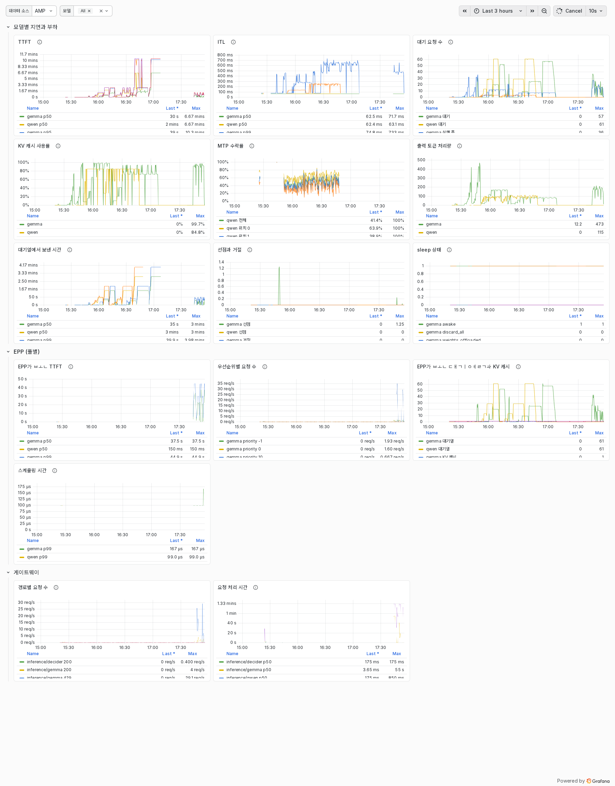

# 8단계. 관측과 측정

2026-11-14에 관측 구성을 적용하고 측정 네 가지를 한 번씩 실행했습니다. 원시 자료는 `results/2026-11-14-observability/`, `results/2026-11-14-ttft-segments/`, `results/2026-11-14-coldstart/`, `results/2026-11-14-slo/`, `results/2026-11-14-priority/`에 있습니다.

2026-11-15에 BFF를 ECS Fargate에서 EKS 파드로 옮긴 뒤 구간별 TTFT를 다시 쟀습니다(2절의 "2026-11-15 재측정", 원시 자료 `results/2026-11-15-ttft-segments-eks/`).

2026-11-15에 Qwen의 동시 실행 한도의 원인을 확인하는 측정을 두 번 더 했습니다(3절의 "Qwen의 동시 3건 한도"). prefix caching을 끈 구성과 MTP를 끈 구성이고, 원시 자료는 `results/2026-11-15-slo-qwen-no-prefix-cache/`와 `results/2026-11-15-slo-qwen-no-mtp/`에 있습니다.

g7e.2xlarge의 값은 1부와 2부의 측정에서 가져왔습니다. 콜드 스타트는 1부 원고의 전체 시험 결과표(2026-08-30), 처리량은 `gemma4-vllm/results-g7e/`의 원시 결과(2026-08-06)입니다. 두 환경의 차이는 다음과 같아서, 나란히 놓은 값은 같은 조건의 비교가 아닙니다.

| 항목 | g7e.2xlarge (1부, 2부) | g6e.4xlarge (이 환경) |
|---|---|---|
| GPU | RTX PRO 6000 Blackwell 96GB | L40S 48GB |
| vLLM | v0.26.0 | v0.33.0 |
| Gemma 4 31B 체크포인트 | NVFP4 (31.22GiB) | FP8-dynamic (30.63GiB) |
| `--max-model-len` | 8192 | 16384 |
| KV 캐시 | 125,023 토큰 | 34,052 토큰 (3절의 측정 때. compile 캐시를 복원한 기동은 45,321 토큰, 3절의 "읽을 때 알아 둘 점") |
| 용량 유형 | Spot | On-Demand |
| Ready 판정 주기 | 10초 | 1초 |

## 관측

| 구성 요소 | 내용 |
|---|---|
| 수집기 | Prometheus v3.16.0을 agent 모드로 1개(`k8s/observability`). 네임스페이스 `monitoring`, system 노드 |
| 저장소 | Amazon Managed Service for Prometheus 워크스페이스 `ow-on-gpu`. 수집기가 Pod Identity의 역할로 remote write를 서명 |
| 수집 대상 | vLLM 파드 2개(5초 주기), EPP 파드 4개, 게이트웨이 파드 2개(15초 주기). 모두 `up` |
| 대시보드 | `k8s/observability/dashboards/serving.json`. 패널 15개, 쿼리 27개 |

- EPP의 `/metrics`는 토큰 없이는 401입니다. 수집기의 ServiceAccount 토큰과 `/metrics` 비리소스 경로의 `get` 권한(ClusterRole `ow-on-gpu-metrics-reader`)으로 수집됩니다. 4단계에서 확인하지 못한 "EPP가 vLLM 지표를 읽는지"는 `llm_d_epp_average_queue_size`와 `llm_d_epp_average_kv_cache_utilization`에 값이 들어오는 것으로 확인했습니다.
- Qwen 파드의 NetworkPolicy에 수집기를 허용하는 항목을 더했습니다.
- 대시보드의 쿼리 27개를 AMP에 보내 모두 값이 나오는 것을 확인했습니다(`dashboard-queries.txt`). 작업 장비에 Grafana 13.0.2를 컨테이너로 띄워 AMP를 데이터 소스로 붙였을 때 모든 패널이 오류와 빈 값 없이 그려졌습니다.

모델별로 나눠 보는 지표와 쿼리입니다.

| 지표 | 쿼리의 원본 지표 |
|---|---|
| TTFT | `vllm:time_to_first_token_seconds` |
| ITL | `vllm:inter_token_latency_seconds` |
| 대기 요청 수 | `vllm:num_requests_waiting`, `vllm:num_requests_running` |
| KV 캐시 사용률 | `vllm:kv_cache_usage_perc` |
| MTP 수락률 | `vllm:spec_decode_num_accepted_tokens_total` / `vllm:spec_decode_num_draft_tokens_total`, 위치별은 `..._per_pos_total` / `vllm:spec_decode_num_drafts_total` |

MTP 수락률은 speculative decoding을 켠 Qwen에만 값이 있습니다. 적용 전에 Qwen 파드의 `/metrics`에서 읽은 누적값으로는 드래프트 1,791회에 위치별 수락이 1,550, 1,354, 1,143개였습니다(위치별 수락률 0.87, 0.76, 0.64).

## 1. 콜드 스타트 구간 분해

`bench/coldstart/measure.py`로 쟀습니다. 1부의 측정 스크립트와 같은 방법입니다. 파드 생성부터 Ready까지를 전체로 잡고, 노드 프로비저닝은 NodeClaim 생성부터 노드 Ready까지, 이미지 pull은 kubelet의 `Pulled` 이벤트, 가중치 로드와 엔진 초기화는 vLLM 로그의 표식으로 잡았습니다.

기준 구성은 1부와 같습니다. 모델 버킷을 Mountpoint for Amazon S3(FUSE)로 마운트해 vLLM 기본 로더로 읽고, compile 캐시를 컨테이너 안에 두고, 이미지를 미리 받지 않는 노드를 씁니다(`bench/coldstart/k8s/gemma-baseline.yaml`). 최적화 구성은 지금 서빙하는 구성입니다(runai_streamer로 S3에서 직접 읽기, S3의 compile 캐시를 initContainer로 복원, hostPath 캐시, 이미지 사전 pull). 시나리오마다 한 번 쟀습니다.

### 시나리오별 전체 시간

| 시나리오 | g7e.2xlarge, Gemma NVFP4 | g6e.4xlarge, Gemma FP8 | g6e.4xlarge, Qwen FP8 |
|---|---:|---:|---:|
| 콜드, 기준 구성 | 428초 | 394초 | |
| 콜드, 최적화 구성 | 226초 | 260초 | 290초 |
| 웜 재시작, 기준 구성 | 314초 | 214초 | |
| 웜 재시작, 최적화 구성 | 133초 | 86초 | 123초 |
| sleep 복귀 | 0.97초 | | 3.67초, 3.70초 |

- 이 환경의 Gemma는 콜드가 394초에서 260초로 34%, 웜 재시작이 214초에서 86초로 60% 줄었습니다. g7e에서는 각각 47%, 58%였습니다.
- Qwen의 기준 구성은 재지 않았습니다. Gemma는 sleep mode를 쓰지 않아 sleep 복귀 값이 없습니다.

### Gemma의 구간 분해

| 구간 | 콜드 기준 g7e | 콜드 기준 g6e | 콜드 최적화 g7e | 콜드 최적화 g6e | 웜 기준 g7e | 웜 기준 g6e | 웜 최적화 g7e | 웜 최적화 g6e |
|---|---:|---:|---:|---:|---:|---:|---:|---:|
| 노드 프로비저닝 | 30 | 55.0 | 30 | 71.0 | | | | |
| 이미지 pull | 65.1 | 111.1 | 32.2 | 71.0 | | | | |
| 가중치 로드 | 127.6 | 59.6 | 20.1 | 19.2 | 127.8 | 59.1 | 19.1 | 19.6 |
| 엔진 초기화 | 93.9 | 95.5 | 30.4 | 23.7 | 94.0 | 95.6 | 29.6 | 23.7 |
| (그중 torch.compile) | 50.8 | 61.0 | 7.0 | 0.9 | 51.0 | 60.8 | 6.6 | 0.9 |
| 기타 | 111.4 | 72.7 | 113.3 | 75.1 | 92.2 | 59.3 | 84.3 | 42.7 |
| 합계 | 428 | 394 | 226 | 260 | 314 | 214 | 133 | 86 |

단위는 초입니다. g7e의 값은 1부 원고의 전체 시험 결과표에서 가져왔고(콜드 최적화는 stage5-cold-hit, 웜 최적화는 stage2-warm-2nd), g7e의 기타는 합계에서 나머지 구간을 빼서 계산했습니다.

- **가중치 로드**: Mountpoint로 읽으면 59.6초, 스트리밍 로더로 읽으면 19.2초입니다(3.1배). g7e에서는 127.6초에서 20.1초였습니다. 스트리밍 로더의 값은 두 환경이 거의 같고, Mountpoint 쪽이 이 환경에서 절반입니다. vLLM 버전(v0.26.0과 v0.33.0)과 Mountpoint 드라이버 버전이 달라 원인을 가르지는 못합니다.
- **엔진 초기화**: 캐시가 없으면 95.5초(compile 61.0초), S3에서 복원한 캐시가 있으면 23.7초(compile 0.9초)입니다. 새 노드에서 S3의 캐시 522개(90.8MB)를 3.3초에 복원했고 compile이 0.9초로 끝났습니다. 3단계에서 확인하지 못한 "새 노드에서 S3 캐시가 적중하는지"가 확인됐습니다.
- **이미지 pull**: 사전 pull이 없으면 111.1초, 있으면 kubelet 기준 71.0초입니다. 사전 pull은 노드가 뜨는 동안 먼저 시작하므로 kubelet이 본 시간이 줄어듭니다. g7e(65.1초에서 32.2초)보다 두 값 모두 깁니다.
- **노드 프로비저닝**: 55초와 71초로 g7e의 30초보다 깁니다. 3단계의 첫 노드는 118초였습니다.
- **웜 재시작 기준 구성이 214초로 g7e의 314초보다 짧은 것**은 가중치 로드(59.1초와 127.8초)와 기타(59.3초와 92.2초)의 차이입니다. g7e는 Ready 판정 주기가 10초여서 기타에 그 오차가 들어 있습니다.
- 기타에는 스케줄링 대기, 컨테이너 생성, vLLM 프로세스가 가중치 로드에 들어가기 전의 시간, 엔진 초기화 뒤 API 서버가 뜨는 시간이 들어갑니다. 웜 재시작 최적화 구성에서 컨테이너 시작부터 Ready까지는 82초였고, 그중 가중치와 엔진 초기화가 43.3초입니다.
- 가중치 로드는 vLLM 로그의 `Model loading took`으로 잡았습니다. v0.33.0은 스트리밍 로더 경로에서 `Loading weights took`을 남기지 않습니다. 기준 구성에는 두 줄이 모두 있고 값은 55.9초와 59.6초였습니다. 1부는 `Loading weights took`을 썼습니다.

### Qwen의 구간 분해

| 구간 | 콜드, 최적화 구성 | 웜 재시작, 최적화 구성 |
|---|---:|---:|
| 노드 프로비저닝 | 63.0 | |
| 이미지 pull | 77.5 | |
| 가중치 로드 | 34.9 | 35.4 |
| 엔진 초기화 | 42.5 | 41.8 |
| (그중 torch.compile) | 0.8 | 0.9 |
| 기타 | 72.1 | 45.8 |
| 합계 | 290 | 123 |

- 새 노드에서 S3의 캐시 2,056개(216.7MB)를 복원하는 데 10초가 걸렸고 compile은 0.8초였습니다.
- Qwen은 가중치가 더 커서(34.39GiB) 가중치 로드가 Gemma보다 15초쯤 깁니다.

### sleep 진입과 복귀

웜 재시작으로 새로 뜬 Qwen 파드에서 `bench/sleep/measure.py`를 두 번 돌렸습니다.

| 항목 | 첫 번째 | 두 번째 | g7e (Gemma NVFP4) |
|---|---:|---:|---:|
| sleep 진입 | 31.71초 | 2.98초 | 12.8초 |
| 복귀 (깨우기 API 응답까지) | 3.70초 | 3.67초 | 0.97초 |
| 복귀 뒤 게이트웨이 요청이 성공하기까지 | 1.35초 | 0.35초 | |

- 파드가 뜬 뒤 첫 sleep이 31.71초로, 3단계에서 본 값(31.71초)과 같습니다. 두 번째부터는 2.98초입니다. 새 파드에서 다시 확인했으므로 첫 sleep이 오래 걸리는 것은 재현됩니다.
- 복귀는 3.7초로 6단계의 값(3.66초)과 같습니다.

### 측정 중 있었던 일

- 콜드 시나리오마다 이전 GPU 노드를 지우는 데 6분 30초쯤 걸렸습니다(15:27:01에서 15:33:33, 17:07:56에서 17:14:27, 17:24:47에서 17:31:12). 이 시간은 시작 시간에 넣지 않았습니다.
- 기준 구성에서는 Mountpoint 파드(`mount-s3` 네임스페이스)가 새 노드에 함께 떴습니다.
- 네 시나리오 모두 컨테이너 재시작은 없었습니다.

## 2. 구간별 TTFT

`bench/ttft/segments.py`로 CloudFront 주소에 요청을 하나씩 보냈습니다. 모델마다 20건이고(연결을 여는 첫 요청 1건은 뺌), 최대 출력은 32토큰입니다. Gemma는 상담 업무로 도구를 부르지 않는 질문, Qwen은 코딩 업무의 짧은 질문을 썼습니다.

두 번 쟀습니다. 2026-11-14에는 BFF가 ECS Fargate 태스크였고 게이트웨이를 내부 NLB로 불렀습니다. 2026-11-15에 BFF를 EKS 파드로 옮긴 뒤 같은 방법으로 다시 쟀고, 이때 BFF는 게이트웨이와 깨우기 API를 Service로 부릅니다(`docs/07-bff.md`). 지금 구성의 값은 아래 "2026-11-15 재측정"에 있습니다.

### 2026-11-14 측정 (BFF가 ECS Fargate)

각 구간의 기록을 요청마다 이었습니다. 사용자 쪽은 클라이언트가 잰 시각, CloudFront는 응답의 `Server-Timing` 헤더, ALB는 접근 로그, BFF는 자체 로그, vLLM은 요청 전후의 지표 차이입니다. ALB 로그와 BFF 로그는 `X-Amzn-Trace-Id`로, BFF 로그와 클라이언트 기록은 요청 ID로 이었습니다. 40건 모두 여섯 구간이 다 이어졌습니다.

| 구간 | Gemma 중앙값 | Gemma 최대 | Qwen 중앙값 | Qwen 최대 | 근거 |
|---|---|---|---|---|---|
| 사용자와 엣지 사이 | 2.1ms | 2.7ms | 2.5ms | 5.1ms | 클라이언트의 응답 헤더 도착 시간 - `cdn-downstream-fbl` |
| CloudFront | 4.0ms | 118.0ms | 4.0ms | 107.0ms | `cdn-downstream-fbl` - ALB의 처리 시간 |
| ALB | 1.7ms | 3.1ms | 1.6ms | 2.2ms | ALB의 처리 시간 - BFF가 응답 헤더를 내보내기까지 |
| BFF | 0.1ms | 0.1ms | 13.9ms | 26.0ms | 판단 시간 + 깨우기 API 호출 시간 |
| 게이트웨이 (NLB, agentgateway, EPP) | 7.4ms | 16.8ms | 8.1ms | 13.2ms | BFF가 본 첫 내용까지의 시간 - vLLM의 TTFT |
| vLLM | 63.2ms | 65.5ms | 148.1ms | 153.0ms | `vllm:time_to_first_token_seconds`의 요청 전후 차이 |
| 나머지 | -0.6ms | -0.2ms | -0.5ms | -0.4ms | 사용자가 본 첫 내용 - 위 여섯 구간 |
| **사용자가 본 첫 내용** | **77.7ms** | **196.2ms** | **179.6ms** | **290.0ms** | 클라이언트 측정 |

- 첫 내용까지의 시간은 대부분 vLLM입니다. Gemma는 77.7ms 중 63.2ms(81%), Qwen은 179.6ms 중 148.1ms(82%)입니다.
- vLLM의 TTFT는 거의 다 prefill입니다. 대기열 시간은 두 모델 모두 0ms였고(요청을 하나씩 보냈으므로), prefill이 Gemma 59.2ms, Qwen 144.8ms였습니다.
- 경로 구간(사용자에서 게이트웨이까지)의 중앙값을 더하면 Gemma 15.3ms, Qwen 30.1ms입니다. Qwen이 더 긴 것은 BFF가 Qwen 요청마다 깨우기 API를 한 번 부르기 때문입니다(13.8ms).
- EPP의 스케줄링 시간은 요청당 0.03ms였습니다(`llm_d_epp_scheduler_e2e_duration_seconds`의 차이).
- CloudFront 구간은 모델마다 20건 중 18건이 3ms에서 8ms였고, 2건이 훨씬 길었습니다(Gemma 100ms와 118ms, Qwen 61ms와 107ms). 이 2건 때문에 사용자가 본 첫 내용의 최댓값이 중앙값보다 100ms쯤 큽니다. 원인은 확인하지 못했습니다.
- 응답 헤더는 첫 내용보다 먼저 도착합니다(Gemma 17.4ms, Qwen 31.4ms). vLLM이 요청을 받자마자 헤더를 보내기 때문입니다. 그래서 `Server-Timing`과 ALB 로그의 값은 첫 토큰이 아닌 응답 헤더까지의 시간이고, 위 표는 그 값으로 경로의 시간을, vLLM 지표로 생성의 시간을 나눴습니다.
- TLS 연결을 새로 여는 데는 7.6ms(Gemma 측정 때)와 13.7ms(Qwen 측정 때)가 걸렸습니다. 표의 값은 이미 열린 연결로 보낸 요청입니다.
- CloudFront는 오류 응답(401)에는 `Server-Timing`을 붙이지 않았습니다.

### 2026-11-15 재측정 (BFF가 EKS 파드)

원시 자료는 `results/2026-11-15-ttft-segments-eks/`입니다. BFF 로그를 CloudWatch 로그 그룹이 아닌 파드의 표준 출력(`kubectl -n app logs`)에서 읽는 것 말고는 방법이 같습니다. 40건 모두 여섯 구간이 이어졌습니다.

| 구간 | Gemma 중앙값 | Gemma 최대 | Qwen 중앙값 | Qwen 최대 | 2026-11-14의 중앙값 (Gemma, Qwen) |
|---|---|---|---|---|---|
| 사용자와 엣지 사이 | 1.8ms | 3.2ms | 1.9ms | 5.0ms | 2.1ms, 2.5ms |
| CloudFront | 5.0ms | 79.0ms | 5.0ms | 9.0ms | 4.0ms, 4.0ms |
| ALB | 1.6ms | 4.2ms | 1.6ms | 12.7ms | 1.7ms, 1.6ms |
| BFF | 0.1ms | 0.1ms | 12.8ms | 21.9ms | 0.1ms, 13.9ms |
| 게이트웨이 (agentgateway, EPP) | 9.7ms | 16.4ms | 8.4ms | 78.0ms | 7.4ms, 8.1ms (NLB 포함) |
| vLLM | 63.2ms | 66.6ms | 147.6ms | 160.0ms | 63.2ms, 148.1ms |
| 나머지 | -0.5ms | 6.8ms | -0.6ms | 0.1ms | -0.6ms, -0.5ms |
| **사용자가 본 첫 내용** | **81.9ms** | **153.6ms** | **177.5ms** | **253.1ms** | 77.7ms, 179.6ms |

- 첫 내용까지의 시간은 여전히 대부분 vLLM입니다. Gemma는 81.9ms 중 63.2ms(77%), Qwen은 177.5ms 중 147.6ms(83%)입니다. 첫 내용의 최소는 Gemma 77.9ms, Qwen 172.6ms였습니다.
- prefill은 Gemma 58.8ms, Qwen 144.4ms였고 대기열 시간은 두 모델 모두 0ms였습니다.
- 경로 구간의 중앙값을 더하면 Gemma 18.2ms, Qwen 29.7ms입니다(2026-11-14에는 15.3ms, 30.1ms).
- 경로에서 NLB가 빠졌지만 게이트웨이 구간은 줄지 않았습니다(Gemma 7.4ms에서 9.7ms, Qwen 8.1ms에서 8.4ms). 두 측정 모두 20건의 중앙값이고 한 번씩 잰 것이라, 이 차이가 구성 변경 때문인지 측정 사이의 편차인지는 가를 수 없습니다.
- Qwen의 BFF 구간은 깨우기 API 확인입니다(중앙값 12.8ms, 9.7ms에서 21.8ms). NLB 대신 Service로 부릅니다.
- CloudFront 구간은 Gemma가 20건 중 18건이 3ms에서 7ms였고 2건이 13ms와 79ms였습니다. Qwen은 20건 모두 4ms에서 9ms였습니다. 긴 값의 원인은 확인하지 않았습니다.
- Qwen의 게이트웨이 구간에서 1건이 78.0ms였습니다(나머지는 14.9ms 이하). 원인은 확인하지 않았습니다.
- 응답 헤더는 Gemma 19.8ms, Qwen 32.4ms에 도착했습니다. TLS 연결을 새로 여는 데는 14.5ms(Gemma 측정 때)와 14.2ms(Qwen 측정 때)가 걸렸습니다.

측정 장비가 같은 리전(서울)의 EC2라서 사용자와 엣지 사이의 시간이 짧습니다. 다른 지역의 사용자는 이 구간이 늘어납니다. g7e 환경에는 이 경로(CloudFront, ALB, BFF, 게이트웨이)가 없어 비교할 값이 없습니다.

## 3. SLO 하 처리량

2부와 같은 방법으로 쟀습니다. `vllm bench serve`의 벤치마크로 랜덤 토큰 프롬프트를 워크로드 네 가지, 동시성 일곱 단계(1에서 64)로 보내고, 수준마다 요청 수는 동시성의 8배(16건 이상 256건 이하)입니다. 게이트웨이를 거치지 않고 vLLM Service를 직접 불렀습니다(`bench/slo/run-bench.sh`). Gemma는 네 가지 모두, Qwen은 S1과 S2를 쟀습니다. 실패한 요청은 없었습니다.

- 부하 발생기는 측정 전용 노드(c7i-flex.2xlarge)에서 돌렸습니다. 모델마다 노드가 다릅니다.
- `vllm bench serve`는 GPU가 없는 노드에서 "Failed to infer device type"으로 시작하지 못해서, 같은 벤치마크 모듈(`vllm.benchmarks.serve`)을 직접 불렀습니다(`bench/slo/bench_serve.py`). 인자와 측정 코드는 같습니다.
- 토크나이저는 Hugging Face가 아닌 모델 버킷에서 받았습니다.
- "실행 중 최대"는 그 수준 동안 `vllm:num_requests_running`의 최댓값입니다(AMP, `engine-state.json`).
- 단위는 TTFT와 ITL이 ms입니다. g7e 열은 Gemma 4 31B NVFP4의 값입니다.

### S1 짧은 채팅 (입력 256, 출력 128)

| 동시성 | g7e 출력 tok/s | g7e TTFT p99 | g7e ITL p99 | Gemma 출력 tok/s | Gemma TTFT p99 | Gemma ITL p99 | Gemma 실행 중 최대 | Qwen 출력 tok/s | Qwen TTFT p99 | Qwen ITL p99 | Qwen 실행 중 최대 |
|---:|---:|---:|---:|---:|---:|---:|---:|---:|---:|---:|---:|
| 1 | 38.8 | 900.1 | 25.5 | 18.5 | 86.6 | 57.7 | 1 | 32.5 | 210.4 | 74.3 | 1 |
| 2 | 77.8 | 62.6 | 25.8 | 36.6 | 123.0 | 58.1 | 2 | 58.7 | 280.1 | 109.3 | 2 |
| 4 | 152.3 | 117.6 | 26.2 | 71.5 | 271.6 | 59.0 | 4 | 79.9 | 4,374.5 | 110.3 | 3 |
| 8 | 293.6 | 210.6 | 26.8 | 138.2 | 478.4 | 60.2 | 8 | 91.2 | 9,274.6 | 111.6 | 3 |
| 16 | 556.3 | 407.0 | 27.9 | 248.3 | 973.5 | 88.2 | 16 | 87.9 | 23,394.0 | 111.7 | 3 |
| 32 | 977.9 | 726.8 | 32.1 | 424.4 | 1,760.7 | 394.2 | 32 | 85.0 | 48,678.4 | 110.9 | 3 |
| 64 | 1,871.0 | 306.2 | 36.3 | 447.0 | 12,335.1 | 436.9 | 45 | 90.4 | 91,191.4 | 111.8 | 3 |

### S2 요약과 생성 (입력 1024, 출력 256)

| 동시성 | g7e 출력 tok/s | g7e TTFT p99 | g7e ITL p99 | Gemma 출력 tok/s | Gemma TTFT p99 | Gemma ITL p99 | Gemma 실행 중 최대 | Qwen 출력 tok/s | Qwen TTFT p99 | Qwen ITL p99 | Qwen 실행 중 최대 |
|---:|---:|---:|---:|---:|---:|---:|---:|---:|---:|---:|---:|
| 1 | 39.1 | 98.5 | 25.6 | 18.1 | 266.7 | 58.3 | 1 | 33.6 | 366.3 | 74.5 | 1 |
| 2 | 77.0 | 70.4 | 26.2 | 35.1 | 531.7 | 59.2 | 2 | 67.1 | 570.3 | 74.5 | 2 |
| 4 | 146.8 | 347.8 | 26.9 | 66.4 | 1,093.3 | 61.3 | 4 | 77.8 | 6,495.5 | 267.9 | 3 |
| 8 | 269.1 | 779.9 | 28.5 | 120.4 | 1,848.5 | 253.8 | 8 | 97.6 | 17,092.3 | 259.7 | 3 |
| 16 | 473.4 | 1,498.7 | 31.5 | 163.6 | 19,049.8 | 268.4 | 12 | 99.2 | 40,555.9 | 265.3 | 3 |
| 32 | 655.7 | 3,175.0 | 98.6 | 164.7 | 37,950.4 | 260.0 | 12 | 95.2 | 93,411.1 | 259.3 | 3 |
| 64 | 909.9 | 6,368.6 | 791.1 | 164.0 | 91,297.4 | 268.3 | 12 | 96.5 | 171,819 | 262.7 | 3 |

### S3 분류 (입력 512, 출력 16)

| 동시성 | g7e 출력 tok/s | g7e TTFT p99 | g7e ITL p99 | Gemma 출력 tok/s | Gemma TTFT p99 | Gemma ITL p99 | Gemma 실행 중 최대 |
|---:|---:|---:|---:|---:|---:|---:|---:|
| 1 | 36.6 | 66.5 | 25.5 | 17.0 | 132.9 | 57.6 | 1 |
| 2 | 72.3 | 64.6 | 27.5 | 34.2 | 125.8 | 58.3 | 1 |
| 4 | 121.9 | 207.3 | 30.8 | 56.3 | 489.9 | 63.5 | 4 |
| 8 | 198.6 | 396.1 | 57.8 | 69.3 | 987.1 | 385.5 | 8 |
| 16 | 297.1 | 766.8 | 328.3 | 97.8 | 1,825.8 | 451.3 | 13 |
| 32 | 395.1 | 1,377.1 | 621.4 | 114.4 | 4,196.7 | 440.2 | 21 |
| 64 | 292.5 | 3,019.3 | 748.5 | 114.7 | 8,237.8 | 435.3 | 24 |

### S4 장문 RAG (입력 4096, 출력 256)

| 동시성 | g7e 출력 tok/s | g7e TTFT p99 | g7e ITL p99 | Gemma 출력 tok/s | Gemma TTFT p99 | Gemma ITL p99 | Gemma 실행 중 최대 |
|---:|---:|---:|---:|---:|---:|---:|---:|
| 1 | 36.4 | 460.4 | 26.1 | 17.2 | 1,093.2 | 58.6 | 1 |
| 2 | 75.4 | 93.7 | 26.7 | 31.6 | 1,988.5 | 60.1 | 2 |
| 4 | 130.6 | 1,750.6 | 27.7 | 55.4 | 4,015.7 | 482.9 | 4 |
| 8 | 220.5 | 3,081.8 | 31.4 | 77.3 | 19,509.2 | 537.7 | 7 |
| 16 | 269.2 | 6,940.6 | 873.7 | 80.5 | 43,802.2 | 510.5 | 7 |
| 32 | 342.9 | 13,701.3 | 890.9 | 81.8 | 89,275.9 | 517.2 | 7 |
| 64 | 401.7 | 28,010.0 | 900.1 | 81.7 | 191,573 | 519.3 | 7 |

### SLO를 만족하는 최대 동시성

| 워크로드 | 환경 | TTFT p99 500ms 이하 | ITL p99 50ms 이하 | 둘 다 | 둘 다 만족할 때의 출력 tok/s |
|---|---|---:|---:|---:|---:|
| S1 짧은 채팅 | g7e.2xlarge, Gemma NVFP4 | 64 | 64 | 64 | 1,871.0 |
| S1 짧은 채팅 | g6e.4xlarge, Gemma FP8 | 8 | 없음 | 없음 |  |
| S1 짧은 채팅 | g6e.4xlarge, Qwen FP8 | 2 | 없음 | 없음 |  |
| S2 요약과 생성 | g7e.2xlarge, Gemma NVFP4 | 4 | 16 | 4 | 146.8 |
| S2 요약과 생성 | g6e.4xlarge, Gemma FP8 | 1 | 없음 | 없음 |  |
| S2 요약과 생성 | g6e.4xlarge, Qwen FP8 | 1 | 없음 | 없음 |  |
| S3 분류 | g7e.2xlarge, Gemma NVFP4 | 8 | 4 | 4 | 121.9 |
| S3 분류 | g6e.4xlarge, Gemma FP8 | 4 | 없음 | 없음 |  |
| S4 장문 RAG | g7e.2xlarge, Gemma NVFP4 | 2 | 8 | 2 | 75.4 |
| S4 장문 RAG | g6e.4xlarge, Gemma FP8 | 없음 | 없음 | 없음 |  |

### 읽을 때 알아 둘 점

- **두 기준을 함께 만족하는 수준이 이 환경에는 없습니다.** ITL p99가 동시성 1에서도 Gemma 57.7ms, Qwen 74.3ms로 50ms를 넘습니다. Gemma의 토큰 간격 중앙값이 54ms(초당 18.5토큰)라서, 부하와 무관하게 L40S에서 이 체크포인트의 생성 속도가 기준에 못 미칩니다. g7e에서는 같은 값이 25.2ms(초당 38.8토큰)였습니다.
- TTFT 기준만 보면 Gemma는 S1에서 동시성 8(p99 478ms), S3에서 4, S2에서 1까지 만족하고, S4는 동시성 1에서도 1,093ms입니다.
- Gemma의 최대 출력 처리량은 S1 447.0, S2 164.7, S3 114.7, S4 81.8 tok/s입니다. g7e는 1,871.0, 909.9, 395.1, 401.7 tok/s였습니다.
- Gemma가 동시에 실행한 요청 수는 KV 캐시에 묶입니다. 실행 중 최대는 S1 45건, S3 24건, S2 12건, S4 7건에서 더 늘지 않았고 그 뒤로는 요청이 대기했습니다. 그때의 KV 캐시 사용률은 S1 0.998, S2 0.996, S3 0.993이고 S4는 0.947에서 0.949입니다(`engine-state.json`의 `kv_usage_max`). S4는 0.95에 못 미친 상태에서 대기가 생겼습니다(동시성 8에서 실행 7건, 대기 6건). S2와 S4에서 동시성 16 이후 처리량이 늘지 않고 TTFT만 길어지는 이유입니다. S1의 동시성 64에서는 선점이 81회 일어났습니다.
- **Gemma의 KV 캐시 크기는 기동마다 같지 않았습니다.** 이 절의 측정은 KV 캐시가 5.37GiB(34,052 토큰, `num_gpu_blocks` 4,400)인 파드에서 했습니다. 같은 날 compile 캐시를 복원해 띄운 파드는 7.15GiB(45,321 토큰)였습니다(`results/2026-11-14-coldstart/gemma-cold-optimized.log`, `gemma-warm-optimized.log`). 기동 로그의 활성값 최대(peak activation)가 compile을 한 기동 세 번은 3.45GiB, compile 캐시를 불러온 기동 두 번은 1.67GiB였고, 그 차이 1.78GiB가 그대로 KV 캐시에 더해졌습니다. 가중치 로더는 원인이 아닙니다. 스트리밍 로더를 쓰고 compile을 한 첫 기동도 5.37GiB였습니다(`results/2026-11-14-vllm-first-start/gemma-0.90.log`). vLLM이 기동할 때 재는 활성값 최대에 compile이 쓴 메모리가 들어가는 것으로 보이고, 소스에서 확인하지는 않았습니다. 2026-11-14 17:35부터 떠 있는 지금의 파드는 7.15GiB 쪽입니다(`num_gpu_blocks` 5,856, 2026-11-15 확인). 4절의 우선순위 측정과 2절의 2026-11-15 재측정은 이 파드에서 했습니다. 위 표의 실행 중 최대(S1 45건, S2 12건, S3 24건, S4 7건)는 5.37GiB에서 잰 값이고 7.15GiB에서는 다시 재지 않았습니다.
- **Qwen은 요청 길이와 무관하게 동시에 3건만 실행했습니다.** 요청 하나가 KV 캐시의 28.3%를 잡아(S1과 S2가 같음) 3건에서 84.8%가 되고, 네 번째부터는 `capacity` 사유로 대기했습니다. 그래서 동시성 8부터 처리량이 S1은 초당 85.0에서 91.2토큰, S2는 95.2에서 99.2토큰에 머물고, TTFT p99가 S1의 동시성 4에서 이미 4.4초입니다(S2는 6.5초).
- 이 한도의 원인은 speculative decoding(MTP)입니다. prefix caching이 원인이라는 처음의 추정은 측정으로 기각했습니다. 아래 "Qwen의 동시 3건 한도"에 적었습니다.
- ITL은 스트리밍 조각 사이의 간격입니다. Gemma는 조각 하나가 토큰 하나라서 ITL과 토큰당 시간(TPOT)이 같습니다(동시성 1에서 중앙값 54.0ms와 53.9ms). Qwen은 speculative decoding으로 조각 하나에 여러 토큰이 담겨 오므로(S1 동시성 1의 16건에서 128토큰이 요청에 따라 35에서 115조각, 중앙값 49.5조각) ITL 중앙값은 69.8ms, TPOT 중앙값은 26.6ms입니다. Qwen의 TPOT p99는 동시성 1에서 58.2ms였습니다.
- 랜덤 토큰 프롬프트에서 Qwen의 MTP 위치별 수락률은 S1 동시성 1에서 0.56, 0.43, 0.36이었습니다(S2는 0.60, 0.46, 0.38). 한국어 대화 요청에서 본 값(0.87, 0.76, 0.64)과 다를 수 있으므로 처리량은 워크로드에 따라 달라집니다.
- g7e의 S1은 동시성 1과 32에서 TTFT p99가 기준을 넘고 64에서는 만족합니다. 수준마다 표본이 적어(동시성 1은 16건) p99가 한두 건에 좌우됩니다. 이 환경의 값도 같은 한계가 있습니다.
- 2부에는 같은 L40S(g6e.2xlarge)에서 NVFP4 체크포인트를 vLLM v0.26.0으로 잰 값이 있습니다. S1의 동시성 1에서 ITL 중앙값 45.2ms, 최대 처리량 536.0 tok/s였습니다(`gemma4-vllm/results/SUMMARY.md`). 이 환경의 FP8-dynamic(v0.33.0)은 54.0ms와 447.0 tok/s입니다. 체크포인트, vLLM 버전, `--max-model-len`이 모두 달라 원인을 가르지는 못합니다.

### Qwen의 동시 3건 한도: 원인 확인 (2026-11-15)

처음에는 prefix caching을 켜면 Mamba 캐시가 `align` 모드가 되는 것이 원인이라고 추정했습니다. 이를 확인하려고 Qwen을 `--disable-prefix-caching`으로 다시 띄워 S1을 같은 방법으로 쟀습니다(`bench/slo/k8s/qwen-no-prefix-cache`, v0.33.0에서는 플래그를 지우기만 하면 기본값이 켜짐이라 명시적으로 껐습니다). 측정 뒤 원래 구성으로 되돌렸습니다.

| 동시성 | 켬: 출력 tok/s | 켬: TTFT p99 | 켬: 실행 중 최대 | 끔: 출력 tok/s | 끔: TTFT p99 | 끔: 실행 중 최대 |
|---:|---:|---:|---:|---:|---:|---:|
| 1 | 32.5 | 210.4 | 1 | 27.0 | 253.8 | 2 |
| 2 | 58.7 | 280.1 | 2 | 58.7 | 278.1 | 3 |
| 4 | 79.9 | 4,374.5 | 3 | 85.7 | 3,621.0 | 3 |
| 8 | 91.2 | 9,274.6 | 3 | 89.4 | 9,616.9 | 3 |
| 16 | 87.9 | 23,394.0 | 3 | 82.0 | 24,495.5 | 3 |
| 32 | 85.0 | 48,678.4 | 3 | 87.1 | 47,133.6 | 3 |
| 64 | 90.4 | 91,191.4 | 3 | 85.5 | 96,130.3 | 3 |

- **prefix caching을 꺼도 동시에 3건만 실행했습니다.** 동시성 4부터 실행 중 최대 3건, KV 캐시 사용률 0.848, 대기 사유 `capacity`가 켠 구성과 같고, 처리량도 동시성 8부터 초당 82.0에서 89.4토큰으로 같은 수준입니다(켠 구성은 85.0에서 91.2토큰). prefix caching은 원인이 아닙니다.
- 끈 구성의 동시성 1과 2에서는 실행 중 최대가 한 건씩 많게 잡혔습니다(2건, 3건). 이유는 확인하지 않았습니다. 동시성 1의 처리량(27.0과 32.5)과 TTFT p99(253.8과 210.4ms)의 차이도 한 번씩 잰 값이라 원인을 가르지 못합니다.
- 기동 로그에서 달라진 것은 Mamba 그룹의 블록 크기뿐입니다(1,600토큰에서 32,768토큰). attention 블록을 1,600토큰으로 맞춘다는 줄(`Setting attention block size to 1600 tokens to ensure that attention page size is >= mamba page size`)은 두 구성에 모두 있습니다. 끈 구성은 compile 캐시가 맞지 않아 compile에 62.6초가 걸렸습니다(원래 구성은 0.8초).

원인은 vLLM v0.33.0의 소스에서 확인했습니다.

- KV 캐시는 네 그룹입니다(기동 로그의 `kv cache group sizes`). 세 개가 Mamba 상태 그룹이고 하나가 attention 그룹입니다. 블록 하나의 메모리는 Mamba 상태 한 벌의 크기에 맞춰져 있고, attention 블록 하나가 1,600토큰입니다.
- Mamba 상태 그룹은 speculative decoding을 쓰면 요청마다 추측 토큰 수만큼 블록을 더 잡습니다. `mamba/abstract.py`가 `num_speculative_blocks`를 `num_speculative_tokens`로 두고, `single_type_kv_cache_manager.py`의 Mamba 관리자가 요청당 `cdiv(num_tokens, block_size) + num_speculative_blocks`개를 할당합니다(`align`이 아닌 모드도 같은 수를 더합니다).
- Qwen은 MTP로 추측 토큰 3개를 씁니다. 그래서 요청 하나가 Mamba 그룹 3개에 4블록씩 12블록, attention 1블록(S1과 S2는 1,600토큰 이하)으로 13블록을 잡습니다.
- KV 캐시 2.45GiB에서 요청이 쓸 수 있는 것은 46블록입니다. 지표 `vllm:cache_config_info`의 `num_gpu_blocks`는 47인데, vLLM이 블록 하나를 자리 표시용(null block)으로 빼 두고 사용률도 `num_gpu_blocks - 1`을 분모로 계산합니다(`vllm/v1/core/block_pool.py`의 `get_usage`). 사용률이 13/46(0.283), 26/46(0.565), 39/46(0.848)으로 측정값과 정확히 맞습니다. 네 번째 요청은 52블록이 필요해 들어가지 못합니다.

이 설명이 맞는지 보려고 MTP를 끈 구성(`--speculative-config`를 뺌, `bench/slo/k8s/qwen-no-mtp`)으로 S1을 다시 쟀습니다. 측정 뒤 원래 구성으로 되돌렸습니다.

| 동시성 | MTP 켬: 출력 tok/s | 켬: TTFT p99 | 켬: 실행 중 최대 | MTP 끔: 출력 tok/s | 끔: TTFT p99 | 끔: 실행 중 최대 |
|---:|---:|---:|---:|---:|---:|---:|
| 1 | 32.5 | 210.4 | 1 | 19.2 | 102.5 | 1 |
| 2 | 58.7 | 280.1 | 2 | 36.6 | 217.0 | 2 |
| 4 | 79.9 | 4,374.5 | 3 | 70.9 | 275.5 | 4 |
| 8 | 91.2 | 9,274.6 | 3 | 136.8 | 486.9 | 8 |
| 16 | 87.9 | 23,394.0 | 3 | 243.7 | 1,020.4 | 16 |
| 32 | 85.0 | 48,678.4 | 3 | 281.8 | 10,000.4 | 20 |
| 64 | 90.4 | 91,191.4 | 3 | 281.8 | 27,360.8 | 20 |

- **MTP를 끄면 동시에 20건까지 실행합니다.** 요청 하나의 KV 캐시 사용률이 0.0488(4/82)로, 소스에서 읽은 대로 요청당 4블록(Mamba 그룹 3개에 1블록씩과 attention 1블록)입니다. 20건에서 80/82(0.976)가 되고 그 뒤로는 대기합니다.
- 쓸 수 있는 블록도 46에서 82로 늘었습니다(`num_gpu_blocks`는 47에서 83). MTP 헤드가 빠지면서 KV 캐시에 쓸 수 있는 메모리가 2.45GiB에서 4.0GiB가 됐습니다(기동 로그의 `Available KV cache memory`). 요청당 블록이 13에서 4로 줄어든 것과 겹쳐 한도가 3건에서 20건이 됐습니다.
- **최대 처리량은 초당 91.2토큰에서 281.8토큰으로 3.1배입니다.** TTFT p99 500ms 기준을 만족하는 동시성도 2에서 8로 늘었습니다.
- **요청 하나는 느려집니다.** 동시성 1에서 초당 32.5토큰이 19.2토큰이 되고, 토큰당 시간(TPOT 중앙값)이 26.6ms에서 51.7ms가 됩니다. MTP는 요청 하나의 속도를 1.7배로 올리는 대신 동시 실행 수를 3으로 묶습니다.
- 처리량은 동시성 4까지는 MTP를 켠 쪽이 크고(79.9와 70.9), 8부터는 끈 쪽이 큽니다(91.2와 136.8).
- ITL p99 50ms 기준은 MTP를 꺼도 만족하지 못합니다(동시성 1에서 58.7ms).
- 추측 토큰을 1개나 2개로 줄인 구성은 재지 않았습니다. 소스의 식으로는 요청당 7블록과 10블록입니다.
- `--use-replayssm`을 켜면 `num_speculative_blocks`가 0이 됩니다. 다만 도움말은 이 옵션을 Mamba2 커널용으로 설명하고 있어 Qwen에 적용되는지는 확인하지 않았습니다.

## 4. 우선순위 효과

`bench/priority/run.py`로 쟀습니다. Gemma에 배치 요청(상품 리뷰 요약, 입력 평균 1,845토큰, 출력 최대 256토큰)을 32개씩 끊임없이 보내 KV 캐시를 채운 상태에서, 상담 요청(짧은 질문, 출력 최대 48토큰)을 1.5초마다 하나씩 90초 동안 60건 보내 첫 토큰까지의 시간을 쟀습니다. 요청은 모두 게이트웨이를 거칩니다. 배치 요청이 429로 거절되면 0.5초 뒤에 다시 보냅니다.

| 경우 | 게이트웨이 (objective 헤더) | 엔진 (본문 priority) |
|---|---|---|
| 없음 | 상담과 배치 모두 헤더 없음 | 둘 다 0 |
| 게이트웨이만 | 상담 priority 10, 배치 -1 | 둘 다 0 |
| 엔진만 | 헤더 없음 | 상담 0, 배치 10 |
| 둘 다 | 상담 10, 배치 -1 | 상담 0, 배치 10 |

| 경우 | 상담 TTFT p50 | p90 | p99 | 배치 완료 | 배치 429 | 배치 출력 tok/s | 엔진 대기 평균 | 엔진 실행 중 최대 |
|---|---:|---:|---:|---:|---:|---:|---:|---:|
| 없음 | 30,895ms | 39,154ms | 39,839ms | 60 | 0 | 170.1 | 31.0 | 27 |
| 게이트웨이만 | 11,183ms | 23,081ms | 27,563ms | 62 | 1,907 | 175.7 | 15.3 | 34 |
| 엔진만 | 190ms | 1,244ms | 1,409ms | 56 | 0 | 159.2 | 17.9 | 20 |
| 둘 다 | 193ms | 1,030ms | 1,433ms | 61 | 1,988 | 173.0 | 9.3 | 20 |

- **엔진 우선순위가 상담 요청의 대기를 없앴습니다.** 우선순위가 없으면 상담 요청이 배치 뒤에서 차례를 기다려 첫 토큰까지 중앙값 30.9초가 걸렸고, 엔진 우선순위를 켜면 0.19초였습니다(p99 1.4초).
- **게이트웨이 우선순위만으로는 11.2초였습니다.** 게이트웨이는 풀이 포화되면 priority가 0보다 낮은 배치 요청을 429로 거절합니다(90초 동안 1,907건). 엔진으로 들어가는 배치가 줄어 대기열이 짧아지지만(평균 31.0에서 15.3), 이미 들어간 배치 요청과 같은 순서로 기다리는 것은 그대로입니다.
- 둘 다 켠 경우의 상담 TTFT는 엔진만 켠 경우와 같은 수준입니다. 차이는 엔진의 대기열입니다(평균 17.9에서 9.3). 게이트웨이가 배치를 거절해 엔진에 쌓이는 요청이 줄었습니다.
- 배치의 출력 처리량은 네 경우 모두 초당 159에서 176토큰입니다. 엔진이 포화된 상태라 우선순위는 누가 먼저 처리되는지를 바꿀 뿐 전체 처리량을 바꾸지 않았습니다.
- 4단계에서 미결정으로 남긴 "batch의 429 처리"는 값으로 확인됐습니다. 배치 클라이언트 32개가 0.5초 간격으로 다시 보내면 90초에 약 1,900건이 429로 돌아옵니다. 배치 작업에는 재시도 간격을 늘리는 처리가 필요합니다.
- 엔진만 켠 경우에도 p90이 1.2초입니다. 상담 요청이 들어온 순간 엔진이 긴 배치 입력의 prefill을 처리하고 있으면 그 단계가 끝날 때까지 기다리는 것으로 추정합니다. 확인하지 않았습니다.
- g7e 환경에는 이 측정이 없습니다.

## 요약

| 측정 | g7e.2xlarge (Gemma NVFP4) | g6e.4xlarge (이 환경) |
|---|---|---|
| 콜드, 기준 구성 | 428초 | Gemma 394초 |
| 콜드, 최적화 구성 | 226초 | Gemma 260초, Qwen 290초 |
| 웜 재시작, 기준 구성 | 314초 | Gemma 214초 |
| 웜 재시작, 최적화 구성 | 133초 | Gemma 86초, Qwen 123초 |
| sleep 복귀 | 0.97초 | Qwen 3.7초 |
| 가중치 로드 (Mountpoint에서 스트리밍 로더로) | 127.6초에서 19.8초 | Gemma 59.6초에서 19.2초 |
| 사용자가 본 첫 내용 (요청 1건씩, 2026-11-15 재측정) | | Gemma 81.9ms, Qwen 177.5ms |
| 그중 vLLM의 TTFT | | Gemma 63.2ms, Qwen 147.6ms |
| 요청 하나의 생성 속도 (S1, 동시성 1) | 초당 38.8토큰 | Gemma 초당 18.5토큰, Qwen 초당 32.5토큰 |
| ITL p99 (S1, 동시성 1) | 25.5ms | Gemma 57.7ms, Qwen 74.3ms |
| TTFT와 ITL을 함께 만족하는 최대 동시성 (S1) | 64 | 없음 |
| 최대 출력 처리량 (S1) | 1,871.0 tok/s | Gemma 447.0 tok/s, Qwen 91.2 tok/s (MTP를 끄면 281.8 tok/s) |
| 배치 부하 중 상담 TTFT p50 (우선순위 없음, 엔진 우선순위) | | 30.9초, 0.19초 |

빈 칸은 그 환경에서 재지 않은 값입니다.

## 다음 결정에 영향을 주는 점

- L40S의 Gemma FP8-dynamic은 토큰 간격이 54ms여서 ITL p99 50ms 기준을 부하와 무관하게 만족하지 못합니다. 이 기준을 유지하려면 GPU나 체크포인트를 바꿔야 하고, 이 구성을 쓰려면 기준을 다시 정해야 합니다.
- Qwen은 지금 설정(MTP 추측 토큰 3개)에서 동시에 3건만 실행합니다. MTP가 요청마다 Mamba 상태 블록을 4배로 잡기 때문이고, prefix caching과는 무관합니다. MTP를 끄면 20건까지 실행하고 S1의 최대 처리량이 3.1배가 되지만 요청 하나의 속도는 초당 32.5토큰에서 19.2토큰으로 줄어듭니다(2026-11-15 측정). 사내 코딩 에이전트처럼 동시 요청이 4건을 넘는 업무라면 MTP를 끄는 쪽이, 한두 명이 쓰는 업무라면 켜는 쪽이 유리합니다. 2부(g7e의 Gemma)는 MTP를 배치 풀에만 쓰도록 권했는데, Qwen에서는 동시 요청이 많을수록 MTP가 불리해서 그 기준을 그대로 옮길 수 없습니다.
- Gemma의 KV 캐시는 compile 캐시를 복원해 띄우면 5.37GiB에서 7.15GiB가 됩니다. 동시 실행 한도가 KV 캐시에 묶이므로 3절의 한도(S1 45건 등)는 지금 떠 있는 파드에서는 더 클 수 있고, 다시 재야 압니다.
- 상담 요청을 배치 부하에서 지키는 것은 엔진 우선순위입니다. 게이트웨이의 InferenceObjective는 배치를 거절해 대기열을 줄이는 역할을 했습니다.

## 확인하지 못한 것

- 모든 측정은 한 번씩입니다. 반복했을 때의 편차는 재지 않았습니다.
- Qwen에서 추측 토큰을 1개나 2개로 줄였을 때의 동시 실행 수와 처리량. MTP를 끈 구성은 S1만 쟀고 S2는 재지 않았습니다.
- Qwen의 기준 구성 콜드 스타트.
- 구간별 TTFT에서 CloudFront 구간이 100ms 안팎으로 길어진 요청(모델마다 20건 중 2건)의 원인.
- 게이트웨이를 거친 경로의 SLO 하 처리량. 2부와 맞추려고 vLLM Service를 직접 불렀습니다.
- 우선순위 측정의 Qwen 쪽. Gemma로만 쟀습니다.
- KV 캐시가 7.15GiB인 Gemma 파드(compile 캐시를 복원한 기동)에서의 동시 실행 한도와 처리량. 3절은 5.37GiB인 파드에서 쟀습니다.
- EPP의 `llm_d_epp_request_error_total`에 `ModelServerError`가 올라가는 이유. 수집기를 붙이기 전에 읽은 누적값에서는 요청 수와 같은 값이었습니다(priority 0이 11건, -1이 3건).
