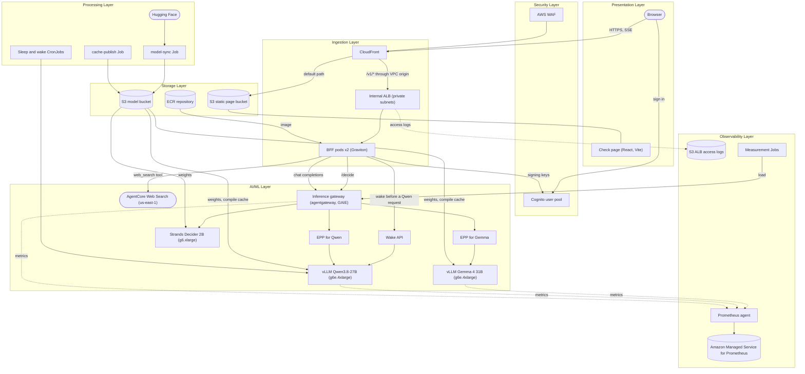
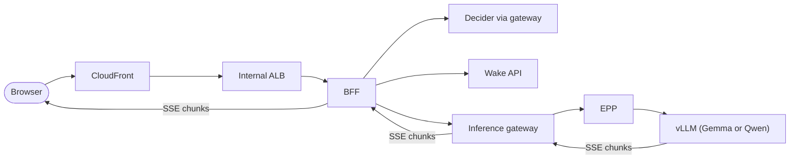

# Architecture

---

# English

## System Overview

ow-on-gpu serves two language models on one Amazon EKS cluster and measures them. Gemma 4 31B and Qwen3.8-27B each run on vLLM v0.33.0 on their own g6e.4xlarge node, behind an inference gateway built on Gateway API Inference Extension and agentgateway.
A BFF in front of the gateway verifies the login, decides which model receives a request, wakes Qwen when it sleeps and runs the tools the models call.
A request travels from the browser through CloudFront and an internal ALB to the BFF, then through the gateway and an endpoint picker to a vLLM pod, and the answer streams back along the same path as SSE.

## Components

### Presentation Layer
- **app/web/**: Check page built with React and Vite. Eight views (request, chat, benchmark, routing, status, API call, architecture, build steps) with a Korean and English switch.
- **docs/infographic/**: Python sources of the figures the page and the documents show.

### Security Layer
- **infra/terraform/app.tf**: AWS WAF rate rule on CloudFront and the Cognito user pool. Sign-up is disabled.
- **app/bff/auth.py**: Verifies the Cognito access token on every path except the health check.
- **app/bff/routing.py**: Data policy. Requests with sensitive data go only to Gemma.
- **k8s/sleep-controller/networkpolicies.yaml**: Limits the callers of the wake API.

### Ingestion Layer
- **infra/terraform/app.tf**: CloudFront serves the static page and forwards `/v1/*` through a VPC origin.
- **k8s/bff/**: BFF pods on a Graviton NodePool and the Ingress from which the load balancer controller creates the internal ALB.
- **app/bff/**: BFF. Decides the model, calls the Decider, wakes Qwen, runs tool calls, relays SSE.

### AI/ML Layer
- **k8s/gateway/**: Gateway API and inference extension CRDs, agentgateway, the Gateway.
- **k8s/gemma/**: vLLM for Gemma 4 31B with its InferencePool, endpoint picker and routes.
- **k8s/qwen/**: vLLM for Qwen3.8-27B with sleep mode and MTP speculative decoding.
- **k8s/decider/**: Strands Decider 2B, reached through the gateway at `/decide`.
- **app/bff/websearch.py**: Web search tool that calls Amazon Bedrock AgentCore Web Search in us-east-1.

### Processing Layer
- **jobs/model-sync/**: Job that streams model weights from Hugging Face into S3.
- **jobs/cache-publish/**: Job that publishes the compile cache from a node to S3.
- **k8s/sleep-controller/**: CronJobs that put Qwen to sleep on weekdays at 19:00 and wake it at 08:30 (Asia/Seoul), and the wake API.

### Storage Layer
- **infra/terraform/storage.tf**: S3 model bucket for weights and compile caches. Serving pods read only from here.
- **infra/terraform/app.tf**: S3 bucket of the static page and the ECR repository of the BFF image.

### Observability Layer
- **k8s/observability/**: Prometheus agent that sends vLLM, endpoint picker and gateway metrics to Amazon Managed Service for Prometheus, and the dashboard JSON.
- **bench/**: Measurement scripts for cold start, sleep recovery, TTFT by segment, throughput under the SLO and priority.
- **results/**: Raw output of every measurement.

## Full Architecture Diagram

## Data Flow Summary

The BFF asks the Decider only when no rule decides the model, and calls the wake API only before a Qwen request.

## Infrastructure

### Deployment Region
- ap-northeast-2 (Seoul). The web search tool calls us-east-1 because the API is not offered in Seoul.

### Modules / Resources
| Module | Resources | Description |
|--------|-----------|-------------|
| `infra/cdk-vpc` (EksVpcStack) | VPC `eks-vpc` 10.200.0.0/16, Public, Private and Isolated subnets in 4 AZs, NAT gateway per AZ, S3 and DynamoDB gateway endpoints, 11 interface endpoints | Network managed by AWS CDK. Terraform only looks it up |
| `infra/terraform/network.tf` | `data.aws_vpc`, `data.aws_subnets`, `aws_ec2_tag` | Looks up the VPC and subnets and tags subnets for Karpenter and the load balancer controller |
| `infra/terraform/eks.tf` | `aws_eks_cluster`, `aws_eks_node_group`, `aws_eks_addon`, `aws_iam_role` | Cluster `ow-on-gpu` (EKS 1.37), managed node group `addons` (2 x m7g.large), core add-ons |
| `infra/terraform/karpenter.tf` | `helm_release`, `aws_cloudformation_stack`, `aws_iam_role`, `aws_eks_pod_identity_association`, `aws_eks_access_entry` | Karpenter 1.15 and the role its nodes use |
| `infra/terraform/lbc.tf` | `helm_release`, `aws_iam_policy`, `aws_iam_role`, `aws_eks_pod_identity_association` | AWS Load Balancer Controller, which creates the internal ALB from an Ingress |
| `infra/terraform/storage.tf` | `aws_s3_bucket`, `aws_iam_role`, `aws_iam_role_policy`, `aws_eks_pod_identity_association` | Model bucket and the roles of serving pods and model jobs |
| `infra/terraform/observability.tf` | `aws_prometheus_workspace`, `aws_s3_bucket`, `aws_eks_addon`, `aws_iam_role`, `aws_cloudfront_response_headers_policy` | Prometheus workspace, collector role, ALB access-log bucket, Mountpoint for Amazon S3 CSI add-on |
| `infra/terraform/app.tf` | `aws_cloudfront_distribution`, `aws_wafv2_web_acl`, `aws_cognito_user_pool`, `aws_cognito_user_pool_client`, `aws_s3_bucket`, `aws_s3_object`, `aws_ecr_repository`, `aws_security_group` | Edge and login: CloudFront with WAF, Cognito, static page objects, BFF image repository |
| `infra/terraform/bff_eks.tf` | `aws_cloudfront_vpc_origin`, `aws_iam_role`, `aws_iam_role_policy`, `aws_eks_pod_identity_association` | BFF pod role and the VPC origin that points CloudFront at the internal ALB |

### Deployed Resources
- Site: `https://<CloudFront domain>` (the default path serves the static page, `/v1/*` goes to the BFF)
- Cluster: `ow-on-gpu`, namespaces `inference`, `model-jobs`, `app`, `monitoring`, `agentgateway-system`
- NodePools: `gemma-od`, `qwen-od`, `decider`, `system`, `app`, `bench`
- Nodes as of 2026-11-16: 2 x g6e.4xlarge, 1 x g6.xlarge, 2 x c7i-flex.xlarge, 2 x c7g.large, 2 x m7g.large

## Key Design Decisions

- FP8 checkpoints for both models: the L40S (Ada, SM 8.9) cannot run NVFP4.
- A per-channel FP8-dynamic checkpoint for Qwen: the official block FP8 checkpoint needs a kernel that Ada does not support.
- `--gpu-memory-utilization 0.90` for Qwen: at 0.85 only 0.24GiB was left for the KV cache and the engine failed to start.
- `--max-num-seqs 32` for Qwen: the default of 1024 failed at engine start for lack of Mamba cache blocks.
- An exec readiness probe on `/is_sleeping` for Qwen: `/health` returns 200 while the model sleeps.
- Recreate strategy for the vLLM Deployments: one GPU holds one pod.
- No zone requirement on the GPU NodePools: Karpenter picks an AZ that has capacity.
- Deterministic rules before the Decider: fixed-format sensitive data (resident registration numbers, card numbers) is filtered by rules first, and the Decider is only an aid for cases without a format.
- When the Decider is silent or below the confidence threshold, the request is handled as Gemma, thinking off, sensitive.
- The BFF relays SSE chunk by chunk: collecting the response breaks streaming.
- Gateway and endpoint picker replicas spread over AZs: when they stop, neither model answers.
- Batch work bypasses CloudFront and calls the gateway through an internal NLB: the CloudFront origin response timeout does not fit long batch requests.
- No web search on sensitive requests: the search query would leave the Region.
- A compile cache prefix that names the vLLM version, model, precision and GPU architecture: when any of them changes, the cache is published under a new prefix.
- Cognito users created by a script: the password never enters code or the Terraform state.

## Operations
- No runbook has been written yet. `docs/runbooks/` holds the template only.
- Build steps and their checks: `prompts.md` and the stage documents `docs/03-vllm.md` to `docs/08-results.md`.
- Deploying the BFF and the page: the `/deploy` command (`.claude/commands/deploy.md`), which shows the diff and waits for approval.
- First steps for a new contributor: [docs/onboarding.md](onboarding.md).
- Rules and confirmed decisions: `AGENT.md`.

---

# 한국어

## 시스템 개요

ow-on-gpu는 Amazon EKS 클러스터 하나에서 언어 모델 둘을 서빙하고 측정합니다. Gemma 4 31B와 Qwen3.8-27B가 각자의 g6e.4xlarge 노드에서 vLLM v0.33.0으로 실행되고, 그 앞에 Gateway API Inference Extension과 agentgateway로 만든 추론 게이트웨이가 있습니다.
게이트웨이 앞의 BFF가 로그인을 확인하고, 요청을 어느 모델이 받을지 정하고, 잠든 Qwen을 깨우고, 모델이 부르는 도구를 실행합니다.
요청은 브라우저에서 CloudFront와 내부 ALB를 거쳐 BFF로 가고, 게이트웨이와 엔드포인트 선택기를 거쳐 vLLM 파드에 닿습니다. 응답은 같은 길로 SSE로 돌아옵니다.

## 구성 요소

### Presentation Layer
- **app/web/**: React와 Vite로 만든 확인용 페이지. 보기 여덟 개(요청, 대화, 성능 평가, 경로 판단, 상태, API 호출, 구조, 구축 과정)와 한영 전환이 있습니다.
- **docs/infographic/**: 화면과 문서가 보여 주는 그림의 Python 소스입니다.

### Security Layer
- **infra/terraform/app.tf**: CloudFront에 붙은 AWS WAF 속도 규칙과 Cognito 사용자 풀입니다. 가입은 막았습니다.
- **app/bff/auth.py**: 상태 점검을 뺀 모든 경로에서 Cognito 액세스 토큰을 검증합니다.
- **app/bff/routing.py**: 데이터 정책입니다. 민감 정보가 있는 요청은 Gemma로만 보냅니다.
- **k8s/sleep-controller/networkpolicies.yaml**: 깨우기 API의 호출자를 제한합니다.

### Ingestion Layer
- **infra/terraform/app.tf**: CloudFront가 정적 페이지를 제공하고 `/v1/*`를 VPC origin으로 보냅니다.
- **k8s/bff/**: Graviton NodePool의 BFF 파드와, 로드 밸런서 컨트롤러가 내부 ALB를 만드는 Ingress입니다.
- **app/bff/**: BFF입니다. 모델을 정하고, Decider를 부르고, Qwen을 깨우고, 도구 호출을 실행하고, SSE를 전달합니다.

### AI/ML Layer
- **k8s/gateway/**: Gateway API와 추론 확장의 CRD, agentgateway, Gateway입니다.
- **k8s/gemma/**: Gemma 4 31B의 vLLM과 InferencePool, 엔드포인트 선택기, 경로입니다.
- **k8s/qwen/**: Qwen3.8-27B의 vLLM입니다. sleep mode와 MTP 추측 디코딩을 씁니다.
- **k8s/decider/**: Strands Decider 2B입니다. 게이트웨이의 `/decide`로 부릅니다.
- **app/bff/websearch.py**: us-east-1의 Amazon Bedrock AgentCore Web Search를 부르는 웹 검색 도구입니다.

### Processing Layer
- **jobs/model-sync/**: Hugging Face의 모델 가중치를 S3로 스트리밍 적재하는 Job입니다.
- **jobs/cache-publish/**: 노드의 compile 캐시를 S3에 게시하는 Job입니다.
- **k8s/sleep-controller/**: 평일 19:00에 Qwen을 재우고 08:30에 깨우는 CronJob(Asia/Seoul)과 깨우기 API입니다.

### Storage Layer
- **infra/terraform/storage.tf**: 가중치와 compile 캐시를 두는 S3 모델 버킷입니다. 서빙 파드는 여기서만 읽습니다.
- **infra/terraform/app.tf**: 정적 페이지의 S3 버킷과 BFF 이미지의 ECR 저장소입니다.

### Observability Layer
- **k8s/observability/**: vLLM, 엔드포인트 선택기, 게이트웨이의 지표를 Amazon Managed Service for Prometheus로 보내는 Prometheus agent와 대시보드 JSON입니다.
- **bench/**: 콜드 스타트, sleep 복귀, 구간별 TTFT, SLO 하 처리량, 우선순위를 재는 측정 스크립트입니다.
- **results/**: 모든 측정의 원시 출력입니다.

## 전체 아키텍처 그림

## 데이터 흐름 요약

BFF는 규칙으로 모델이 정해지지 않을 때만 Decider에 묻고, Qwen 요청 앞에서만 깨우기 API를 부릅니다.

## 인프라

### 배포 리전
- ap-northeast-2(서울). 웹 검색 도구는 서울에 API가 없어 us-east-1을 부릅니다.

### 모듈과 리소스
| 모듈 | 리소스 | 설명 |
|--------|-----------|-------------|
| `infra/cdk-vpc` (EksVpcStack) | VPC `eks-vpc` 10.200.0.0/16, Public, Private and Isolated subnets in 4 AZs, NAT gateway per AZ, S3 and DynamoDB gateway endpoints, 11 interface endpoints | AWS CDK가 관리하는 네트워크. Terraform은 조회만 함 |
| `infra/terraform/network.tf` | `data.aws_vpc`, `data.aws_subnets`, `aws_ec2_tag` | VPC와 서브넷을 조회하고 Karpenter와 로드 밸런서 컨트롤러용 태그를 붙임 |
| `infra/terraform/eks.tf` | `aws_eks_cluster`, `aws_eks_node_group`, `aws_eks_addon`, `aws_iam_role` | 클러스터 `ow-on-gpu`(EKS 1.37), 관리형 노드 그룹 `addons`(m7g.large 2대), 주요 애드온 |
| `infra/terraform/karpenter.tf` | `helm_release`, `aws_cloudformation_stack`, `aws_iam_role`, `aws_eks_pod_identity_association`, `aws_eks_access_entry` | Karpenter 1.15와 노드가 쓰는 역할 |
| `infra/terraform/lbc.tf` | `helm_release`, `aws_iam_policy`, `aws_iam_role`, `aws_eks_pod_identity_association` | Ingress에서 내부 ALB를 만드는 AWS Load Balancer Controller |
| `infra/terraform/storage.tf` | `aws_s3_bucket`, `aws_iam_role`, `aws_iam_role_policy`, `aws_eks_pod_identity_association` | 모델 버킷, 서빙 파드와 모델 Job의 역할 |
| `infra/terraform/observability.tf` | `aws_prometheus_workspace`, `aws_s3_bucket`, `aws_eks_addon`, `aws_iam_role`, `aws_cloudfront_response_headers_policy` | Prometheus 작업 공간, 수집기 역할, ALB 접근 로그 버킷, Mountpoint for Amazon S3 CSI 애드온 |
| `infra/terraform/app.tf` | `aws_cloudfront_distribution`, `aws_wafv2_web_acl`, `aws_cognito_user_pool`, `aws_cognito_user_pool_client`, `aws_s3_bucket`, `aws_s3_object`, `aws_ecr_repository`, `aws_security_group` | 엣지와 로그인: WAF가 붙은 CloudFront, Cognito, 정적 페이지 객체, BFF 이미지 저장소 |
| `infra/terraform/bff_eks.tf` | `aws_cloudfront_vpc_origin`, `aws_iam_role`, `aws_iam_role_policy`, `aws_eks_pod_identity_association` | BFF 파드의 역할과, CloudFront가 내부 ALB를 가리키게 하는 VPC origin |

### 배포된 리소스
- 사이트: `https://<CloudFront domain>` (기본 경로는 정적 페이지, `/v1/*`는 BFF)
- 클러스터: `ow-on-gpu`, 네임스페이스 `inference`, `model-jobs`, `app`, `monitoring`, `agentgateway-system`
- NodePool: `gemma-od`, `qwen-od`, `decider`, `system`, `app`, `bench`
- 2026-11-16 기준 노드: g6e.4xlarge 2대, g6.xlarge 1대, c7i-flex.xlarge 2대, c7g.large 2대, m7g.large 2대

## 주요 설계 결정

- 두 모델 모두 FP8 체크포인트를 씁니다. L40S(Ada, SM 8.9)는 NVFP4를 쓸 수 없습니다.
- Qwen은 per-channel FP8-dynamic 체크포인트를 씁니다. 공식 block FP8 체크포인트는 Ada가 지원하지 않는 커널이 필요합니다.
- Qwen의 `--gpu-memory-utilization`은 0.90입니다. 0.85에서는 KV 캐시에 0.24GiB만 남아 엔진이 시작하지 못했습니다.
- Qwen의 `--max-num-seqs`는 32입니다. 기본값 1024는 Mamba 캐시 블록이 부족해 엔진 시작에서 실패했습니다.
- Qwen의 readinessProbe는 `/is_sleeping`을 보는 exec probe입니다. `/health`는 모델이 잠든 동안에도 200을 돌려줍니다.
- vLLM Deployment는 Recreate 전략입니다. GPU 한 장에 파드 하나이기 때문입니다.
- GPU NodePool에 zone 요구 조건을 두지 않습니다. Karpenter가 용량이 있는 AZ를 고릅니다.
- 결정적 규칙이 Decider보다 먼저입니다. 형식이 정해진 민감 정보(주민등록번호, 카드번호)는 규칙으로 먼저 거르고, Decider는 형식이 없는 경우의 보조 판단에만 씁니다.
- Decider가 답하지 않거나 신뢰도가 기준보다 낮으면 Gemma, thinking 끔, 민감 정보 있음으로 처리합니다.
- BFF는 SSE를 청크 단위로 전달합니다. 응답을 모으면 스트리밍이 깨집니다.
- 게이트웨이와 엔드포인트 선택기의 복제본을 AZ에 나눠 둡니다. 이들이 멈추면 두 모델 모두 응답하지 못합니다.
- 배치 작업은 CloudFront를 거치지 않고 내부 NLB로 게이트웨이를 부릅니다. CloudFront의 오리진 응답 타임아웃이 긴 배치 요청에 맞지 않습니다.
- 민감 정보 요청에는 웹 검색을 붙이지 않습니다. 검색어가 리전 밖으로 나가기 때문입니다.
- compile 캐시 prefix에 vLLM 버전, 모델, 정밀도, GPU 아키텍처를 넣습니다. 하나라도 바뀌면 새 prefix로 게시합니다.
- Cognito 사용자는 스크립트로 만듭니다. 비밀번호가 코드와 Terraform 상태에 들어가지 않습니다.

## 운영
- 런북은 아직 없습니다. `docs/runbooks/`에는 템플릿만 있습니다.
- 구축 단계와 확인 방법: `prompts.md`와 단계 문서 `docs/03-vllm.md`에서 `docs/08-results.md`.
- BFF와 화면의 배포: `/deploy` 명령(`.claude/commands/deploy.md`). 차이를 보여 주고 승인을 기다립니다.
- 처음 작업하는 사람의 첫 단계: [docs/onboarding.md](onboarding.md).
- 규칙과 확정된 결정: `AGENT.md`.
